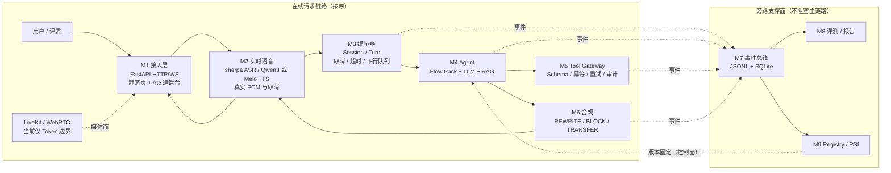
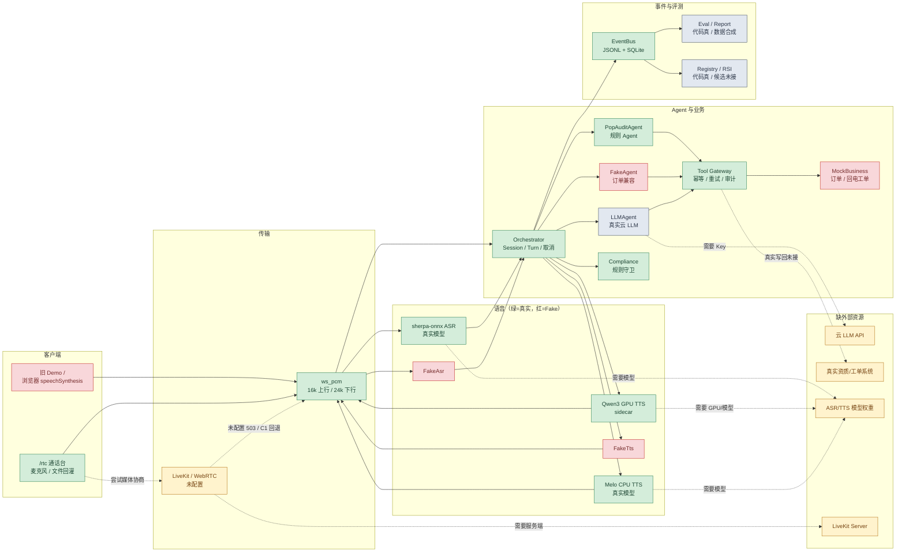
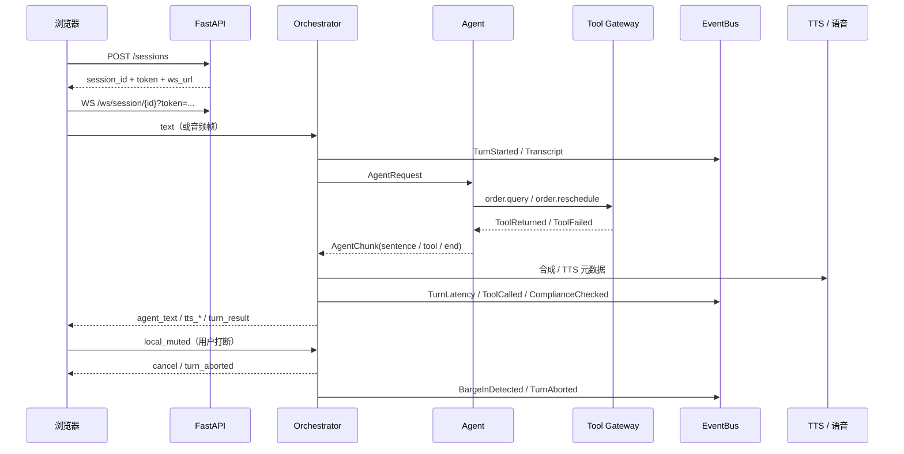
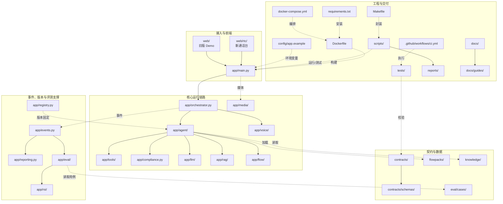

# 智语外呼 · 语音外呼客服数字员工

> 一个面向竞赛演示的**京东 POP 品牌入驻资质审核驳回外呼**数字员工：实时语音交互、场景话术、工具调用、合规守卫、事件追踪、评测与 RSI 自进化。
>
> 已接入 **流式 sherpa ASR + 默认 Qwen3 GPU TTS / 可切换 Melo CPU TTS**。运行时离线加载模型，真实 PCM 下行与取消已接通；默认业务场景为 **POP 资质审核驳回外呼**。启动步骤见 [生产语音指南](docs/guides/production-voice.md)，场景说明见 [POP 场景文档](docs/16-pop-audit-scenario.md)。

Windows 多场景通话、语音收轮和自动 RSI 的复现步骤见 [POP 联调说明](eval/pop/contest-rsi-nov08.md)。

| 现在能做什么 | 现在还不能做什么 |
|---|---|
| 3 轮任务闭环、POP 资质驳回（电话/京麦）、FAQ、转人工；真实 PCM ASR/TTS | 授权产品音色、真机麦克风声学验收 |
| 打断（barge-in）、停止播报、`turn_aborted` | 真实 LiveKit 媒体面 |
| 工具校验/幂等/重试/审计、回电工单、合规拦截 | 真实云 LLM 意图/Function Calling |
| JSONL + SQLite 事件、时延、回放、评测、RSI | 真实业务系统写回、真机声学时延 |

**入口**：旧 Demo `/` ｜ 新通话台 `/rtc/` ｜ OpenAPI `/docs` ｜ 健康检查 `/healthz`

---

## 0. 当前四个入口（先看这里）

| 入口 | 定位 | 当前链路 | 状态 |
|---|---|---|---|
| **8081** | 主开发 / 稳定级联 | 真实 sherpa ASR → 规则 Agent → Melo TTS | 可演示；规则回复 |
| **8091** | 比赛入口 | `serve_pop_contest.py`，POP 六阶段 + Resilient 规则 | 可演示；不调用 LLM |
| **8084** | LLM Agent 实验 | sherpa → `LLMAgent` + Qwen3-4B → Melo | 可对话；5–14s，未达实时 |
| **8096** | 伪双工 Mock Lab | `MockDuplexProvider` 事件协议，无真实音频 | 协议实验；独立分支 |

### 当前链路

```text
浏览器麦克风
  → WebSocket ws_pcm 16k
  → sherpa ASR
  → Orchestrator（turn / cancel / timeout）
  → Agent
      ├─ 规则：PopCompetitionAgent（81/91）
      └─ LLM：LLMAgent + Qwen3-4B（84）
  → Compliance / ToolGateway
  → Melo CPU TTS
  → PCM 下行 → 浏览器播放
```

**81/91/84 都是半双工级联，不是真双工。**
当前不是 LiveKit/WebRTC，也没有真实双工模型；`/rtc` 仍是“用户说完 → ASR → Agent → TTS”。

### LiveKit 归谁 / 现在缺它做不了什么

| 项 | 负责人 |
|---|---|
| LiveKit Server、媒体服务、TURN/AEC 接入 | **天命**（按 [docs/03](docs/03-interface-contract-v0.1.md) 的媒体服务职责） |
| LiveKit 客户端 SDK、前端入房、客户端 VAD/播放埋点 | **cx** |
| 服务端业务/Agent/ASR/TTS | 不由 cx 负责服务端媒体 |

当前 LiveKit **未配置、未启动**，`aiortc` 也未安装。没有它：

- 能做：本地 `ws_pcm` 级联、真实 sherpa/Melo、三轮 POP 流程、事件面板；
- 不能做：正式 WebRTC 媒体面、TURN/NAT 穿透、浏览器 AEC/回声验收、真实网络抖动下的打断；
- 不能宣称“真双工”或“比赛 WebRTC 已完成”；
- 不能把 8096 的 Mock 当成 LiveKit 替代品。

### 路线划分（A/B 保留，C 为实验）

```text
A. 稳定级联：81 主开发 / 91 比赛；真实语音 + 规则 Agent
B. 伪双工实验：8096 + feature/duplex-adapter；只有 Mock 事件协议
C. LLM 实验：84；Agent 接入，不是双工
```

**默认走 A，B 仅作备选，C 仅作实验。**
81/91 不默认启用伪双工，`DUPLEX_PROVIDER=off`；8096 需要手动启动；A/B 不合并，84 不是双工。

### 当前任务

1. **AI 接入**：84 已注入真实 `request_id/brand/reject_l1/l2/l3`，确认词和复读已修；
2. **回复速度**：当前 5–14 秒，目标 P50 ≤2 秒，未完成；
3. **双路线**：81/91 稳定级联保留，8096 伪双工独立保留；
4. **许可证**：ASR 权重、Melo 数据授权、NVIDIA/LGPL/GCC 等按 [docs/20](docs/20-license-checklist.md) 推进。

启动与实验说明：

- 81/91 见 [§9 启动](#9-启动)
- 84 见 [docs/22](docs/22-ai-integration-status.md)
- 8096 属 `feature/duplex-adapter` 本地 worktree，不在 81/91 主链路
- LiveKit 媒体测试：<http://127.0.0.1:8085/rtc/livekit-test.html>（只入房/麦克风，未接 ASR 桥）

---

## 1. 架构图



> M7/M8/M9 属于旁路支撑面，不参与在线请求顺序：M3/M4/M5/M6 在运行时把事件写入 M7；M8 从 M7 读取评测数据；M9 向 M4 提供版本固定。在线主链路为 `M1 → M2 → M3 → M4 → M5/M6 → M2 → M1`。

设计约束：

- **模块化单体**：一个 asyncio 进程，进程内 EventBus；不引入 MQ/微服务。
- **双状态机**：M3 管“会话/轮次”，M4 管“业务流程”。
- **Agent 决策、Gateway 执行**：工具参数校验、幂等、超时、审计都在 M5。
- **合规三层**：生成前约束、句级门禁、工具守卫；BLOCK 必须能取消 TTS。
- **可回滚**：Registry 管 candidate → production → previous；RSI 只提议，不直接改生产。

### 1.1 当前运行时链路（Fake / 正式 / 缺外部资源）

> 绿色 = 正式代码链路可用；红色 = Fake/Mock；灰色 = 代码已实现但数据/候选未接；黄色 = 缺外部资源。



当前默认：

- `AGENT_PROVIDER=fake` 走 `PopAuditAgent`；`AGENT_PROVIDER=llm` 才走 `LLMAgent`（需 Key）。
- `APP_ENV=test` 默认 `FakeAsr`/`FakeTts`；生产默认 sherpa ASR + Qwen3 TTS，CPU 可切 Melo。
- W1 演示默认 `TRANSPORT_PREF=ws_pcm`；`auto` 模式下未配置 LiveKit 走 C1 静默回落。
- 真实业务系统、模型权重、LiveKit Server、云 LLM Key 均未随仓库提供。

## 2. API 调用关系图



关键消息：`session_ready`、`hello_ack`、`transcript`、`agent_text`、`tts_started/sentence/completed`、`compliance`、`turn_result`、`turn_end`、`turn_aborted`、`session_ended`。字段以 [03 契约](docs/03-interface-contract-v0.1.md)、[11 v0.2 补丁](docs/11-contract-v0.2-patch.md)、[04 事件](docs/04-event-schema-v0.1.md) 为准。

## 3. 仓库结构图




> 需要按模块看“哪个目录放什么”，见 [仓库结构图（Mermaid）](docs/guides/repository-map.md)；需要按请求看调用顺序，见上面的 API 时序图。

## 4. 已经进行的工作

| 模块 | 已完成 | 状态 |
|---|---|---|
| 需求/架构/契约 | 01–04、11 补丁、P1–P5、WS golden fixture | ✅ |
| M1 接入 | HTTP/WS、静态页、`/rtc`、`ws_url` 带 token、503 降级 | ✅ Fake 路径 |
| M2 语音 | sherpa 流式 ASR、Qwen3/Melo、真实 PCM、分组/时长/取消 | ✅ 开发环境已验证；目标容器待验收 |
| M3 编排 | Session/Turn、取消、超时、打断、`turn_aborted` | ✅ |
| M4 Agent | FakeAgent、PopAuditAgent、LLMAgent（Qwen3-4B 本地实验、上下文/Function Calling/RAG）、Flow Pack | ✅ 代码；🟡 真实 Key/速度 |
| M5 Tool Gateway | Schema、幂等、超时、1 次重试、审计、`callback.create` | ✅ |
| M6 合规 | 禁语 REWRITE、隐私 BLOCK、转人工、事件 | ✅ 规则待外置 |
| M7 事件 | JSONL + SQLite、`seq`、`TurnLatency t0..t9`、回放 | ✅ |
| M8 评测/报告 | `/eval/run`、headless、失败标签、Markdown、POP 6 场景 | ✅ |
| M9 Registry/RSI | candidate → production → previous、bootstrap 门禁 | ✅ 代码；🟡 真实候选 |
| POP 场景 | 68 条主表场景、52 条话术、11 组 QA、28 条追问、三级分类、电话/京麦分流 | ✅ 知识库/Flow/评测 |
| 前端 | 旧 Demo + `/rtc` 通话台、打断修复、无麦回放 | ✅ |
| 交付 | CPU app + GPU sidecar profile、离线模型挂载 | ✅ CPU/Qwen 镜像已构建；模型仍挂载 |
| 测试 | 原契约测试 + provider/ASR/TTS/取消测试、4 组前端 | 见 [生产语音指南](docs/guides/production-voice.md) |

## 5. 最近一次更新

**2026-11-10：四个入口与 84 LLM 实验**。新增 84 `LLMAgent` 真实 POP 上下文注入、确认词/复读修复、短确认跳过无关 RAG；8084 可完成“可以 → 说明具体驳回项”的上下文对话。当前 84 仍为 5–14 秒/轮，未达可用速度。前端新增最新自主回复与后端事件面板；8091 比赛入口、8096 伪双工 Mock 分别保留。

**2026-11-07：本地 CPU 真语音链路**。sherpa ASR + Melo CPU TTS 在 Python 3.11 / ONNX Runtime 1.28 下跑通；新增 `app/voice/ort_runtime.py` 预加载本地 ORT，避免 Windows System32 旧 DLL；新增 `scripts/run_local_voice.ps1`。模型与 `.web311`/`.venv311` 均不提交仓库。

**2026-11-07：POP 评测与离线 RSI**。新增 POP 六阶段 Agent、规则/Judge/评测 Runner、本地写回、离线策略对比、可选 WebRTC DataChannel 与比赛启动器；默认 app 仍走 `PopAuditAgent`，比赛路径通过 `POP_CONTEST=1` 或 `scripts/serve_pop_contest.py` 启用。

**2026-11-07：LLM Agent 接入**。`LLMAgent` 支持 Function Calling、对话历史与 Flow 状态；工具名保持点号契约，OpenAI Function 使用安全别名并映射回 `order.query` 等内部名；POP 场景使用独立 Prompt；`.env` 仅在 dev/local 加载；补充 `speech_ended` 处理，修复该消息触发的 `UNKNOWN_MESSAGE`。

**2026-11-06：赛题场景落地**。默认场景切换为 POP 品牌入驻资质审核驳回外呼；新增 68 条主表场景知识库、52 条整句话术、11 组高频 QA、28 条特殊追问、POP Flow、6 条评测用例和 `callback.create` 回电工单。

**2026-11-03：真实语音接入**。运行命令和剩余边界见 [生产语音指南](docs/guides/production-voice.md)。

**2026-11-01，`650a3ea`：cx 打断修复合入。**

修复了“打断后客服复读/继续播原内容”的三个叠加缺陷：

1. 手动打断不再触发 300ms 自动 `unduck`；等服务端 `cancel/turn_aborted` 裁决。
2. 误打断恢复从**下一句**继续，不重播已播句子。
3. 服务端取消后，旧 `reply_id` 在 session 层封禁；后续 `tts_*` / `audio_chunk` 全部丢弃。
4. 纯打断不说话时，Mock 用**新 `reply_id`** 下发兜底话术，不复活旧回复。
5. `APP_BASE` 默认同源，`/rtc/` 接真后端不再依赖 `?app=`。

验证：前端 `barge.mjs`、golden/pcm/uplink、mock smoke 全过；CI run [41319214781](https://github.com/SLR979111/AI-call/actions/runs/41319214781) success。

**2026-11-02**：新增比赛指标自检脚本与本文档/指南整理。

## 6. 各部分剩余工作

| 部分 | 剩余工作 | 负责人 | 验收 |
|---|---|---|---|
| 语音 | 授权产品音色、目标 GPU 容器、噪声 ASR/麦克风验收、分组句内精确对齐 | SinCircle | 真机说一句 → 声学首字 P50 有数 |
| 媒体 | LiveKit Server、前端入房、TURN、AEC/打断 | cx / SinCircle | `/rtc/` 真 WebRTC 通话 |
| Agent | 真实 LLM Key、Function Calling、场景 Prompt、多轮改写 | pseudonym | 真实任务成功率 |
| 84 AI 接入 | 84 上下文/确认链路验证；回复速度从 5–14s 降到 P50 ≤2s | pseudonym + 天命 | 84 三轮真机；时延有数 |
| 双路线 | A 稳定级联（81/91）保持；B 伪双工（8096/Mock）独立保留，不合并 | 天命 | A 可交付，B 不阻断 A |
| 许可证 | ASR 权重、Melo 数据授权、NVIDIA/LGPL/GCC、依赖锁 | 天命/SinCircle | 见 docs/20 P0 |
| 业务 | 官方 POP 场景已落地；真实资质系统/工单写回、更多二级分类覆盖 | pseudonym | 真实单据写回 + 场景覆盖 |
| 合规 | 规则外置 `rules.yaml`、质检报告、红队用例 | pseudonym | 严重违规 0 |
| 评测 | 30/20/20 用例、LLM-as-Judge、模拟用户、留出集 | 湖中日月 | 可复现评测报告 |
| RSI | 失败聚类、候选生成、A/B、门禁数据 | 湖中日月 | 一组可展示的改进前后 |
| 交付 | 主办方干净机、模型/端口/离线验证 | 天命 | 一键启动 + 健康 |
| 提交 | 真机数据、测试音频、5min 视频、3/7min 答辩 | 全员 | 提交包完整 |

优先顺序：**84 AI 接入+速度 → 许可证 P0 → 真实业务写回 → 评测/RSI → 交付/提交物**；双路线 A/B 并行保留，不互相阻塞。

## 7. 当前测试

| 测试 | 命令 | 最近结果 |
|---|---|---|
| 单元 + 契约 | `make test` | **111 passed / 5 skipped**（含 POP 规则/策略/评测） |
| 契约 Schema | `make contract-test` | **5 files / 90 docs** |
| 前端协议 | `cd web/rtc && npm test` | golden / PCM / 回灌 / 打断 **4 组 PASS** |
| 端到端 | `make e2e` | 2 轮 + 打断 + 挂断 **PASS** |
| 比赛指标 | `make metric` | **13 项 PASS** |
| 场景评测 | `POST /eval/run` | POP 6 cases，**100%** |
| CI | GitHub Actions | pytest / 契约 / 前端 / WS E2E |

> 端到端“PASS”或“<3s”只是冒烟上限，不等于比赛时延达标；硬门槛是**首字 P50 ≤ 2s**。任何时延结论请用 `make metric-latency` 给出 P50/P95 与样本数。

## 8. 比赛指标测试

`scripts/metric_check.py` 把硬指标变成可重复检查，支持**分段执行**：

```bash
make metric                 # 全量
make metric-closure         # 3 轮闭环 + 写回
make metric-latency         # 首字 P50/P95
make metric-task            # 任务成功率
make metric-compliance      # 合规/不泄露
make metric-barge           # 打断停止/确认
```

当前结果（Fake/协议级，2026-11-02）：

| 检查点 | 实测 | 门槛 | 结果 |
|---|---|---|---|
| 至少 3 轮 | 3 轮 | `>= 3` | ✅ |
| 任务成功 | rescheduled | 成功 | ✅ |
| 工具调用 | `order.query` | 有 `ToolReturned` | ✅ |
| 业务结果回写 | `new_time` + `ticket` | 有结果 | ✅（Fake 模拟） |
| 首字 P50 | 1114 ms | `<= 2000 ms` | ✅ |
| 首字 P95 | 1120 ms | `<= 3000 ms` | ✅ |
| 任务成功率 | 100%（6 cases） | `>= 80%` | ✅ |
| 合规检查 | 4 次 | `> 0` | ✅ |
| PII 泄露 | 无 | 无 | ✅ |
| 打断停止 | 20 ms（客户端上报） | `<= 100 ms` | ✅ |
| 服务端确认 | 212 ms | `<= 2000 ms` | ✅ |

输出：控制台 + `reports/metric-check.md` + 可选 JSON。详细测试点见 [测试指南](docs/guides/testing.md)。

> 这些数字是 **Fake/协议代理指标**，不是真实声学时延；真实 ASR/TTS 接入后用同一脚本复跑，阈值不变。

## 9. 启动

### 9.1 Fake/无模型（快速演示）

```bash
ASR_PROVIDER=fake TTS_PROVIDER=fake docker-compose up -d --build app
```

### 9.2 生产语音（需模型）

先按 [生产语音指南](docs/guides/production-voice.md) 准备模型和授权参考音频。

```bash
# GPU + Qwen3 sidecar
docker compose --profile gpu up -d --build

# 或 CPU-only + Melo
TTS_PROVIDER=melo docker-compose up -d --build app
```

### 9.3 LiveKit 接入后的必做项

当前 `TRANSPORT_PREF=ws_pcm` 是 W1 的防错默认值，不是 LiveKit 修复。接入 LiveKit 后必须完成：

1. 恢复 `TRANSPORT_PREF=auto`，让 `/rtc` 真正参与传输协商。
2. 验证 `/sessions/{id}/rtc` 返回 200、`media_ready`、`transport_switched` 和真实 WebRTC 入房。
3. 保留 `MEDIA_NOT_CONFIGURED` 的 C1 静默回落 `ws_pcm`；不要用默认值把 503 藏起来。
4. 服务端对 `speech_ended` 已支持；其他未知 WS 类型只记 warning，不再用 `UNKNOWN_MESSAGE` 当作致命错误展示。
5. 增加“LiveKit 未配置 → ws_pcm 可用”的回归测试，避免再次用默认值掩盖协议错误。

### 9.4 比赛路径（六阶段 POP）

默认 app 使用三句式的 `PopAuditAgent`；六阶段比赛版使用 `PopCompetitionAgent`，推荐用 contest 启动器：

```bash
# 可选 WebRTC DataChannel（不装也能走 ws_pcm）
python -m pip install -r requirements-rtc.txt

python scripts/serve_pop_contest.py \
  --output ./data/contest \
  --asr-model /path/to/sherpa-asr \
  --tts-model /path/to/melo \
  --doc-id pop-scene-034 \
  --request-id Q983001 \
  --brand 演示品牌 \
  --dialogue-version guided
```

需要 WebRTC DataChannel 时追加 `--rtc-pcm`；不装 `aiortc` 时该参数会明确报错，默认仍走 `ws_pcm`。

也可以在普通 app 生命周期中启用六阶段 Agent：

```bash
export POP_CONTEST=1
export POP_CONTEST_POLICY=guided   # legacy | repair | guided
export POP_CONTEST_CONTEXT='{"request_id":"Q983001","brand":"演示品牌","reject_l1":"入驻","reject_l2":"公司主体","reject_l3":"主体资质到期"}'
```

`POP_CONTEST_CONTEXT` 必须包含 `request_id`、`brand`、`reject_l1/l2/l3`；缺失时启动失败，不会用空上下文冒充真实单据。比赛路径的写回记录在 `data/index/pop_contacts.db`，默认 app 的规则路径不写回。

### 9.5 本地 CPU 真语音（sherpa + Melo，无浏览器）

本地真语音不依赖浏览器 ASR/TTS，也不依赖云：

```text
麦克风 → sherpa ASR → Orchestrator → Agent → Melo CPU TTS → PCM
```

前置：

- Python 3.11/3.12（Python 3.13 没有 sherpa wheel）
- `sherpa-onnx==2.0.1` + `onnxruntime>=1.28`（sherpa 需要 ORT API 28）
- 模型：
  - `models/asr/tokens.txt`、`encoder.int8.onnx`、`decoder.onnx`、`joiner.int8.onnx`
  - `models/melo/model.onnx`、`tokens.txt`、`lexicon.txt`、`dict/`、四个 `.fst`
- 官方权重：GitHub Release [`weights-v1`](https://github.com/SLR979111/AI-call/releases/tag/weights-v1)，包含 ASR/Melo/Qwen 资产和 `SHA256SUMS`；本地 ASR/Melo 文件已逐文件校验一致。

启动：

```powershell
.\scripts\run_local_voice.ps1
```

或手动：

```powershell
$env:ASR_PROVIDER='sherpa'
$env:TTS_PROVIDER='melo'
$env:ASR_MODEL_DIR="$PWD\models\asr"
$env:MELO_MODEL_DIR="$PWD\models\melo"
$env:TTS_FALLBACK_PROVIDER=''
$env:POP_CONTEST='1'
$env:POP_CONTEST_CONTEXT='{"request_id":"Q983001","brand":"演示品牌","reject_l1":"入驻","reject_l2":"公司主体","reject_l3":"主体资质到期"}'
python -m uvicorn app.main:app --host 127.0.0.1 --port 8081
```

验收：

- `GET /voice/status` 返回 `asr.provider=sherpa`、`tts.provider=melo`，两者 `ready=true`
- `/rtc/` 说话出现 transcript，回复有真实人声 PCM
- 若 Windows 的 `System32\onnxruntime.dll` 是旧版，`app/voice/ort_runtime.py` 会优先加载项目内 `.web311/onnxruntime/capi/onnxruntime.dll`；也可用 `ORT_DLL_DIR` 指定目录。

打开：

- 旧 Demo：<http://127.0.0.1:8081/>
- 开发通话台：<http://127.0.0.1:8081/rtc/>
- 开发健康检查：<http://127.0.0.1:8081/healthz>
- 开发语音 readiness：<http://127.0.0.1:8081/voice/status>
- **比赛入口：<http://127.0.0.1:8091/rtc/>**（`scripts/serve_pop_contest.py` 默认端口）
- LLM 实验：<http://127.0.0.1:8084/rtc/>（Qwen3-4B，慢，实验用）
- 伪双工 Mock：<http://127.0.0.1:8096/>（独立分支，无真实音频）

本地 venv、配置项、接口表、Docker 镜像/代理排障见 [开发指南](docs/guides/development.md)。

## 10. 文档索引

| 文档 | 内容 |
|---|---|
| [docs/10](docs/10-master-summary.md) | 总汇总（先看） |
| [docs/13](docs/13-status-and-file-map.md) | 项目现状与文件地图 |
| [docs/01](docs/01-requirement-metric-module-matrix.md)–[04](docs/04-event-schema-v0.1.md) | 需求/架构/契约/事件 |
| [docs/11](docs/11-contract-v0.2-patch.md) | v0.2 / v0.2.1 契约补丁 |
| [docs/12](docs/12-technical-proposal-draft.md) | 技术方案书初稿 |
| [docs/16](docs/16-pop-audit-scenario.md) | POP 资质审核驳回外呼场景与数据映射 |
| [docs/17](docs/17-competition-selfcheck.md) | 官方资料缺口、自建 Mock/评测/时延/合规基线 |
| [docs/20](docs/20-license-checklist.md) | 许可证缺口、责任人和交付前清单 |
| [docs/21](docs/21-license-milestone.md) | 许可证合规 milestone 与 issue 清单 |
| [docs/22](docs/22-ai-integration-status.md) | 84 Agent 接入调试、速度目标、双路线 |
| [docs/23](docs/23-livekit.md) | LiveKit Server/Token/入房测试与音频桥缺口 |
| [licenses/README.md](licenses/README.md) | 第三方许可证原文与 NVIDIA/LGPL/GCC 声明 |
| [docs/guides/development.md](docs/guides/development.md) | 开发、配置、接口、Docker |
| [docs/guides/testing.md](docs/guides/testing.md) | 测试分层、指标点、分段执行 |
| [web/rtc/README.md](web/rtc/README.md) | 新通话台使用说明 |
| [docs/README.md](docs/README.md) | 文档总索引 |

## 11. 边界与合规

- Fake 模式可确定性复现，不依赖 GPU/模型；生产语音需模型与 CPU/GPU 运行时。
- 不接真实外呼、不使用真实 PII、不包含隧道/穿透工具。
- 交付按 CPU-only Docker 设计；真实模型/Key 通过环境变量注入，不进仓库。
- 比赛指标以真实接入后的复跑结果为准；README 中的 Fake 数据均明确标注。
