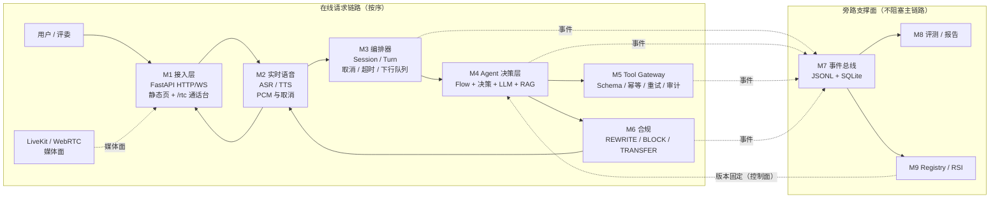
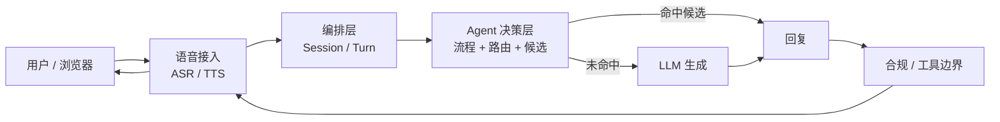
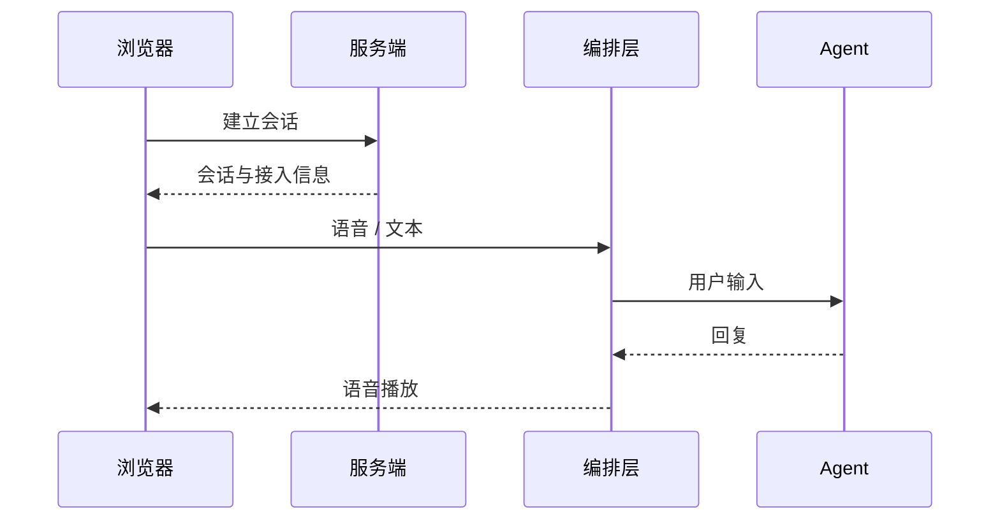

# 智语外呼 · 语音外呼客服数字员工

面向 POP 商家资质审核场景的语音外呼 Demo。  
当前主工作：**预测式对话主链路 v1**。

> 原则：先保证合规和可演示，再谈延迟和模型替换。  
> 8087 是当前验证入口，不是正式 8091；8081 仍是旧镜像，待正式发布。

---

## 1. 当前主链路

```text
用户 / 浏览器
→ 语音接入（ASR / TTS）
→ 编排层（Session / Turn）
→ Agent（身份、路由、候选、未命中时的 LLM）
→ 合规 / 工具边界
→ 语音播放
```

身份确认前不输出品牌、申请单、驳回原因和补材料内容。  
身份确认后不重复询问身份，不重复已经说过的原因。

契约文档：

- [预测式主链路 v1](docs/27-predictive-contract-v1.md)
- [总汇总](docs/10-master-summary.md)
- [接口契约](docs/03-interface-contract-v0.1.md)

### 1.1 系统架构（原 M1–M10 图保留）



> M7/M8/M9 是旁路支撑面，不参与在线顺序。在线主链路为 `M1 → M2 → M3 → M4 → M5/M6 → M2 → M1`。

### 1.2 整体交互流程



只约束大模块之间的交互，不规定内部 Turn 实现、缓存结构、分类器算法和 LLM 调度方式。

### 1.3 API 交互



具体接口字段以 [docs/27](docs/27-predictive-contract-v1.md) 为准，不约束内部实现。

---

## 2. 预测式交互

整体只有一件事：

```text
用户输入 → 路由/候选 → 命中直接回复
                     → 未命中交给 LLM
→ TTS 播放
```

README 只约定交互和输出语义：

```text
输入：用户文本/语音转写
输出：回复文本、是否命中、是否需要 LLM、下一轮候选
```

不约定：

```text
分类器用规则、模型还是向量
缓存怎么存、怎么淘汰
是否异步预测、预测几路
LLM 怎么调度
```

实现细节和接口字段见 [docs/27](docs/27-predictive-contract-v1.md)。

---

## 3. 当前入口

| 入口 | 状态 | 说明 |
|---|---|---|
| 8081 | 200 | 正式 Docker 容器，仍是旧镜像 |
| 8087 | 200 | 当前预测式链路验证入口（`PREDICTIVE_DIALOGUE=1`） |
| 8091 | 未启动 | 比赛入口，待正式启用 |

访问：

```text
http://127.0.0.1:8087/rtc/?transport=livekit
```

接口文档：

```text
http://127.0.0.1:8087/docs
```

---

## 4. 快速启动

### 4.1 启动依赖

先启动 Docker Desktop，确认 LiveKit 可用：

```powershell
curl.exe -sS -o NUL -w "%{http_code}" http://127.0.0.1:7880
```

不是 200 就检查 `aicall-livekit` 容器。

### 4.2 启动 8087

```text
双击 scripts/start-8087.cmd
```

停止：

```text
双击 scripts/stop-8087.cmd
```

### 4.3 正式 8081

8081 当前是旧镜像。正式切换需在窗口内执行：

```powershell
.\scripts\promote-8081-candidate.ps1          # dry-run
.\scripts\promote-8081-candidate.ps1 -Execute # 正式窗口
```

不要直接 `docker restart` 当成发布；必须重建/替换镜像。

---

## 5. 当前工作清单

### P0：正式上线前

| 负责人 | 工作 | 验收 |
|---|---|---|
| 天命 | 8081 候选镜像切换、回滚演练 | 8081 200，失败可回滚 |
| SinCircle | 8081 本地 ASR/TTS 音频回归 | 3 轮有声，延迟有数 |
| pseudonym | 预测式契约、分类器、六阶段/写回 | 身份不越界，阶段可推进 |
| pseudonym + 天命 | 预测式路由/缓存演进（方案自选） | 命中率/P50 有数，未命中 fallback 稳定 |
| 湖中日月 | 分类器评测、P50/P95、合规测试 | 报告可复算 |
| cx | `/rtc/` 播放、t9、AEC/回声 | 3 轮 t9 非空 |

### P1：上线后一周

```text
8081/8091 配置隔离
分类器模型/向量评估
语义路由 / 预测缓存评估
30/20/20 评测集
录屏、指标页、答辩材料
```

### 已具备

```text
身份确认/否认/不明确/结束分支
预生成候选 + fallback
规则分类器
8087 本地启动/停止脚本
正式候选镜像与回滚脚本
```

### 已知限制

```text
8081 仍是旧镜像
8091 未启动
正式 P50/P95 未采集
test_contract / test_voice 受本机 numpy 环境限制未跑
```

---

## 6. 测试

```text
非语音测试：118 passed
跳过：5 项（向量依赖）
```

覆盖：

```text
身份否认
身份不明确
结束语
阶段预设
预测式命中/未命中
fallback
契约 API
```

---

## 7. 目录速览

```text
app/agent/           Agent 与 POP 预设/身份分支
app/predictive/      预生成、分类器、匹配、fallback、v1 API
app/orchestrator.py  Turn/取消/播放
app/media/           LiveKit 桥
app/voice/           ASR/TTS 适配器
contracts/           事件、工具、预测式契约
docs/                架构、契约、状态、回归说明
scripts/             启动、停止、候选镜像升版
web/rtc/             浏览器通话台
```

---

## 8. 文档索引

| 文档 | 用途 |
|---|---|
| [docs/10](docs/10-master-summary.md) | 总汇总与团队任务 |
| [docs/13](docs/13-status-and-file-map.md) | 现状与文件地图 |
| [docs/27](docs/27-predictive-contract-v1.md) | 预测式主链路契约 |
| [docs/24](docs/24-formal-mainline-regression.md) | 正式 8081 回归与回滚 |
| [docs/17](docs/17-competition-selfcheck.md) | 比赛自检与合规基线 |
| [docs/03](docs/03-interface-contract-v0.1.md) | 接口契约 |
| [docs/20](docs/20-license-checklist.md) | 许可证清单 |

---

## 9. 边界

```text
8087 不是正式 8091
8081 的 200 不等于新代码已上线
不要把 fallback 套话当成正式回答 P50
密钥不入库
正式切换必须有回滚
```
