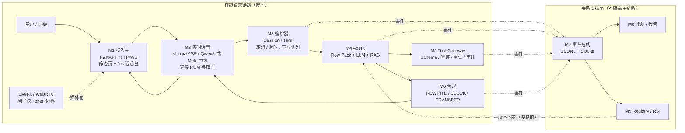
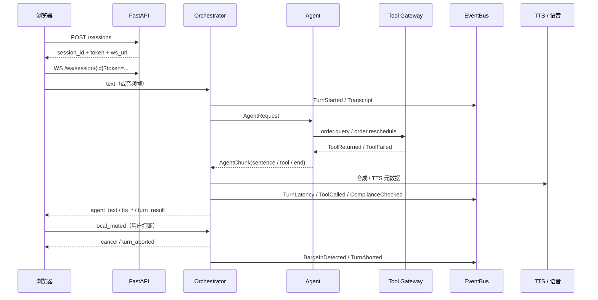
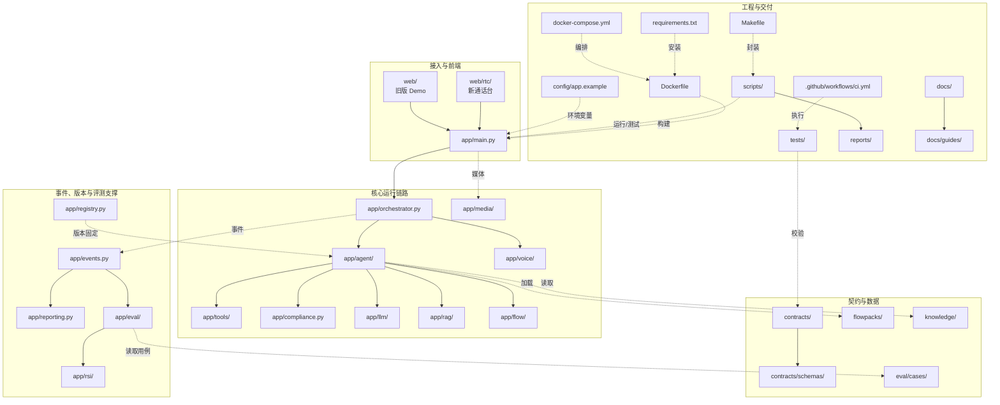

# 智语外呼 · 语音外呼客服数字员工

> 一个面向竞赛演示的**京东 POP 品牌入驻资质审核驳回外呼**数字员工：实时语音交互、场景话术、工具调用、合规守卫、事件追踪、评测与 RSI 自进化。
>
> 已接入 **流式 sherpa ASR + 默认 Qwen3 GPU TTS / 可切换 Melo CPU TTS**。运行时离线加载模型，真实 PCM 下行与取消已接通；默认业务场景为 **POP 资质审核驳回外呼**。启动步骤见 [生产语音指南](docs/guides/production-voice.md)，场景说明见 [POP 场景文档](docs/16-pop-audit-scenario.md)。

| 现在能做什么 | 现在还不能做什么 |
|---|---|
| 3 轮任务闭环、POP 资质驳回（电话/京麦）、FAQ、转人工；真实 PCM ASR/TTS | 授权产品音色、真机麦克风声学验收 |
| 打断（barge-in）、停止播报、`turn_aborted` | 真实 LiveKit 媒体面 |
| 工具校验/幂等/重试/审计、回电工单、合规拦截 | 真实云 LLM 意图/Function Calling |
| JSONL + SQLite 事件、时延、回放、评测、RSI | 真实业务系统写回、真机声学时延 |

**入口**：旧 Demo `/` ｜ 新通话台 `/rtc/` ｜ OpenAPI `/docs` ｜ 健康检查 `/healthz`

---

## 1. 架构图



> M7/M8/M9 属于旁路支撑面，不参与在线请求顺序：M3/M4/M5/M6 在运行时把事件写入 M7；M8 从 M7 读取评测数据；M9 向 M4 提供版本固定。在线主链路为 `M1 → M2 → M3 → M4 → M5/M6 → M2 → M1`。

设计约束：

- **模块化单体**：一个 asyncio 进程，进程内 EventBus；不引入 MQ/微服务。
- **双状态机**：M3 管“会话/轮次”，M4 管“业务流程”。
- **Agent 决策、Gateway 执行**：工具参数校验、幂等、超时、审计都在 M5。
- **合规三层**：生成前约束、句级门禁、工具守卫；BLOCK 必须能取消 TTS。
- **可回滚**：Registry 管 candidate → production → previous；RSI 只提议，不直接改生产。

## 2. API 调用关系图



关键消息：`session_ready`、`hello_ack`、`transcript`、`agent_text`、`tts_started/sentence/completed`、`compliance`、`turn_result`、`turn_end`、`turn_aborted`、`session_ended`。字段以 [03 契约](docs/03-interface-contract-v0.1.md)、[11 v0.2 补丁](docs/11-contract-v0.2-patch.md)、[04 事件](docs/04-event-schema-v0.1.md) 为准。

## 3. 仓库结构图




> 需要按模块看“哪个目录放什么”，见 [仓库结构图（Mermaid）](docs/guides/repository-map.md)；需要按请求看调用顺序，见上面的 API 时序图。

## 4. 已经进行的工作

| 模块 | 已完成 | 状态 |
|---|---|---|
| 需求/架构/契约 | 01–04、11 补丁、P1–P5、WS golden fixture | ✅ |
| M1 接入 | HTTP/WS、静态页、`/rtc`、`ws_url` 带 token、503 降级 | ✅ Fake 路径 |
| M2 语音 | sherpa 流式 ASR、Qwen3/Melo、真实 PCM、分组/时长/取消 | ✅ 开发环境已验证；目标容器待验收 |
| M3 编排 | Session/Turn、取消、超时、打断、`turn_aborted` | ✅ |
| M4 Agent | FakeAgent、PopAuditAgent、LLMAgent（Mock 验证）、RAG、Flow Pack | ✅ 代码；🟡 真实 Key |
| M5 Tool Gateway | Schema、幂等、超时、1 次重试、审计、`callback.create` | ✅ |
| M6 合规 | 禁语 REWRITE、隐私 BLOCK、转人工、事件 | ✅ 规则待外置 |
| M7 事件 | JSONL + SQLite、`seq`、`TurnLatency t0..t9`、回放 | ✅ |
| M8 评测/报告 | `/eval/run`、headless、失败标签、Markdown、POP 6 场景 | ✅ |
| M9 Registry/RSI | candidate → production → previous、bootstrap 门禁 | ✅ 代码；🟡 真实候选 |
| POP 场景 | 68 条主表场景、52 条话术、11 组 QA、28 条追问、三级分类、电话/京麦分流 | ✅ 知识库/Flow/评测 |
| 前端 | 旧 Demo + `/rtc` 通话台、打断修复、无麦回放 | ✅ |
| 交付 | CPU app + GPU sidecar profile、离线模型挂载 | ✅ Compose 校验；新镜像待构建验收 |
| 测试 | 原契约测试 + provider/ASR/TTS/取消测试、4 组前端 | 见 [生产语音指南](docs/guides/production-voice.md) |

## 5. 最近一次更新

**2026-11-06：赛题场景落地**。默认场景切换为 POP 品牌入驻资质审核驳回外呼；新增 68 条主表场景知识库、52 条整句话术、11 组高频 QA、28 条特殊追问、POP Flow、6 条评测用例和 `callback.create` 回电工单。

**2026-11-03：真实语音接入**。运行命令和剩余边界见 [生产语音指南](docs/guides/production-voice.md)。

**2026-11-01，`650a3ea`：cx 打断修复合入。**

修复了“打断后客服复读/继续播原内容”的三个叠加缺陷：

1. 手动打断不再触发 300ms 自动 `unduck`；等服务端 `cancel/turn_aborted` 裁决。
2. 误打断恢复从**下一句**继续，不重播已播句子。
3. 服务端取消后，旧 `reply_id` 在 session 层封禁；后续 `tts_*` / `audio_chunk` 全部丢弃。
4. 纯打断不说话时，Mock 用**新 `reply_id`** 下发兜底话术，不复活旧回复。
5. `APP_BASE` 默认同源，`/rtc/` 接真后端不再依赖 `?app=`。

验证：前端 `barge.mjs`、golden/pcm/uplink、mock smoke 全过；CI run [41319214781](https://github.com/SLR979111/AI-call/actions/runs/41319214781) success。

**2026-11-02**：新增比赛指标自检脚本与本文档/指南整理。

## 6. 各部分剩余工作

| 部分 | 剩余工作 | 负责人 | 验收 |
|---|---|---|---|
| 语音 | 授权产品音色、目标 GPU 容器、噪声 ASR/麦克风验收、分组句内精确对齐 | SinCircle | 真机说一句 → 声学首字 P50 有数 |
| 媒体 | LiveKit Server、前端入房、TURN、AEC/打断 | cx / SinCircle | `/rtc/` 真 WebRTC 通话 |
| Agent | 真实 LLM Key、Function Calling、场景 Prompt、多轮改写 | pseudonym | 真实任务成功率 |
| 业务 | 官方 POP 场景已落地；真实资质系统/工单写回、更多二级分类覆盖 | pseudonym | 真实单据写回 + 场景覆盖 |
| 合规 | 规则外置 `rules.yaml`、质检报告、红队用例 | pseudonym | 严重违规 0 |
| 评测 | 30/20/20 用例、LLM-as-Judge、模拟用户、留出集 | 湖中日月 | 可复现评测报告 |
| RSI | 失败聚类、候选生成、A/B、门禁数据 | 湖中日月 | 一组可展示的改进前后 |
| 交付 | 主办方干净机、模型/端口/离线验证 | 天命 | 一键启动 + 健康 |
| 提交 | 真机数据、测试音频、5min 视频、3/7min 答辩 | 全员 | 提交包完整 |

优先顺序：**LLM Key → 真实业务写回 → 评测/RSI → 交付/提交物**。

## 7. 当前测试

| 测试 | 命令 | 最近结果 |
|---|---|---|
| 单元 + 契约 | `make test` | **58 passed / 5 skipped**（模型集成用例默认跳过） |
| 契约 Schema | `make contract-test` | **5 files / 90 docs** |
| 前端协议 | `cd web/rtc && npm test` | golden / PCM / 回灌 / 打断 **4 组 PASS** |
| 端到端 | `make e2e` | 2 轮 + 打断 + 挂断 **PASS** |
| 比赛指标 | `make metric` | **13 项 PASS** |
| 场景评测 | `POST /eval/run` | POP 6 cases，**100%** |
| CI | GitHub Actions | pytest / 契约 / 前端 / WS E2E |

## 8. 比赛指标测试

`scripts/metric_check.py` 把硬指标变成可重复检查，支持**分段执行**：

```bash
make metric                 # 全量
make metric-closure         # 3 轮闭环 + 写回
make metric-latency         # 首字 P50/P95
make metric-task            # 任务成功率
make metric-compliance      # 合规/不泄露
make metric-barge           # 打断停止/确认
```

当前结果（Fake/协议级，2026-11-02）：

| 检查点 | 实测 | 门槛 | 结果 |
|---|---|---|---|
| 至少 3 轮 | 3 轮 | `>= 3` | ✅ |
| 任务成功 | rescheduled | 成功 | ✅ |
| 工具调用 | `order.query` | 有 `ToolReturned` | ✅ |
| 业务结果回写 | `new_time` + `ticket` | 有结果 | ✅（Fake 模拟） |
| 首字 P50 | 1114 ms | `<= 2000 ms` | ✅ |
| 首字 P95 | 1120 ms | `<= 3000 ms` | ✅ |
| 任务成功率 | 100%（6 cases） | `>= 80%` | ✅ |
| 合规检查 | 4 次 | `> 0` | ✅ |
| PII 泄露 | 无 | 无 | ✅ |
| 打断停止 | 20 ms（客户端上报） | `<= 100 ms` | ✅ |
| 服务端确认 | 212 ms | `<= 2000 ms` | ✅ |

输出：控制台 + `reports/metric-check.md` + 可选 JSON。详细测试点见 [测试指南](docs/guides/testing.md)。

> 这些数字是 **Fake/协议代理指标**，不是真实声学时延；真实 ASR/TTS 接入后用同一脚本复跑，阈值不变。

## 9. 启动

### 9.1 Fake/无模型（快速演示）

```bash
ASR_PROVIDER=fake TTS_PROVIDER=fake docker-compose up -d --build app
```

### 9.2 生产语音（需模型）

先按 [生产语音指南](docs/guides/production-voice.md) 准备模型和授权参考音频。

```bash
# GPU + Qwen3 sidecar
docker compose --profile gpu up -d --build

# 或 CPU-only + Melo
TTS_PROVIDER=melo docker-compose up -d --build app
```

打开：

- 旧 Demo：<http://127.0.0.1:8081/>
- 新通话台：<http://127.0.0.1:8081/rtc/>
- 健康检查：<http://127.0.0.1:8081/healthz>
- 语音 readiness：<http://127.0.0.1:8081/voice/status>

本地 venv、配置项、接口表、Docker 镜像/代理排障见 [开发指南](docs/guides/development.md)。

## 10. 文档索引

| 文档 | 内容 |
|---|---|
| [docs/10](docs/10-master-summary.md) | 总汇总（先看） |
| [docs/13](docs/13-status-and-file-map.md) | 项目现状与文件地图 |
| [docs/01](docs/01-requirement-metric-module-matrix.md)–[04](docs/04-event-schema-v0.1.md) | 需求/架构/契约/事件 |
| [docs/11](docs/11-contract-v0.2-patch.md) | v0.2 / v0.2.1 契约补丁 |
| [docs/12](docs/12-technical-proposal-draft.md) | 技术方案书初稿 |
| [docs/16](docs/16-pop-audit-scenario.md) | POP 资质审核驳回外呼场景与数据映射 |
| [docs/guides/development.md](docs/guides/development.md) | 开发、配置、接口、Docker |
| [docs/guides/testing.md](docs/guides/testing.md) | 测试分层、指标点、分段执行 |
| [web/rtc/README.md](web/rtc/README.md) | 新通话台使用说明 |
| [docs/README.md](docs/README.md) | 文档总索引 |

## 11. 边界与合规

- Fake 模式可确定性复现，不依赖 GPU/模型；生产语音需模型与 CPU/GPU 运行时。
- 不接真实外呼、不使用真实 PII、不包含隧道/穿透工具。
- 交付按 CPU-only Docker 设计；真实模型/Key 通过环境变量注入，不进仓库。
- 比赛指标以真实接入后的复跑结果为准；README 中的 Fake 数据均明确标注。
