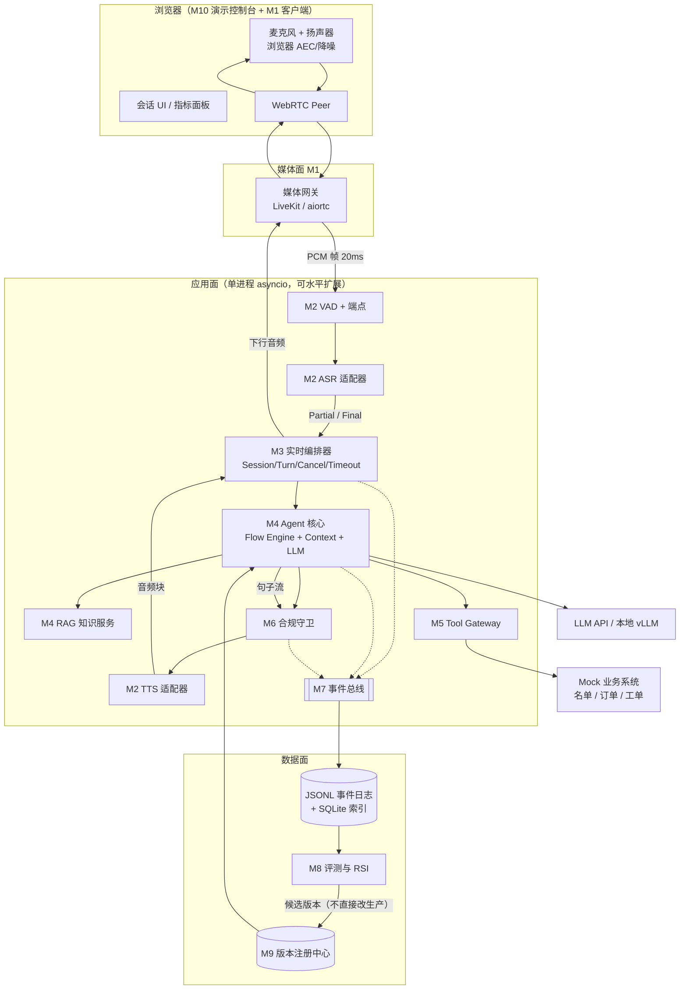
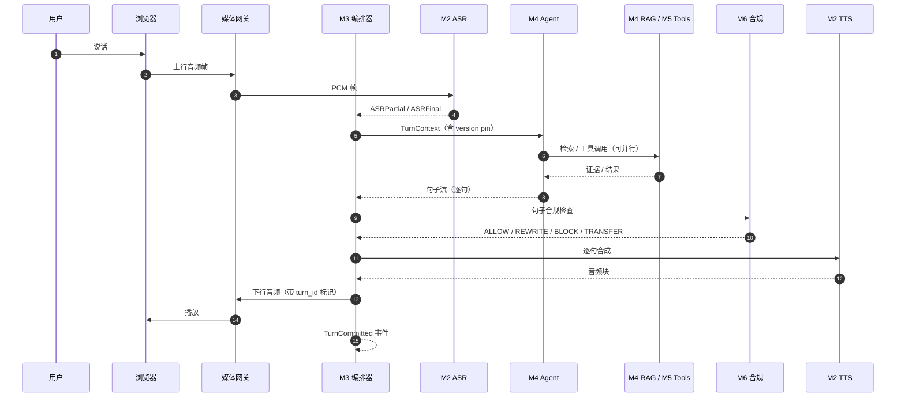
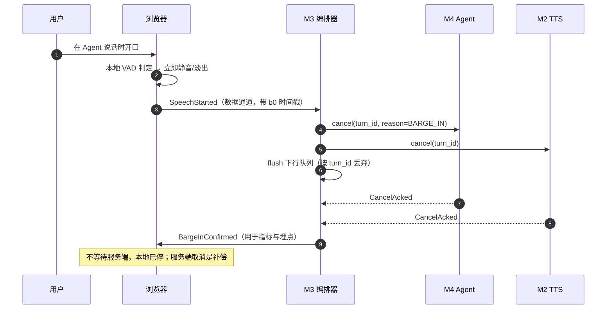

# 02 · Architecture v0.1

> 角色代号说明：本文档的 A–E 是「能力角色」，不是《三周分工》的成员代号；姓名映射与最新责任以 [03 接口契约](03-interface-contract-v0.1.md) 为准。
>
> 状态：Stage 2 交付物，待评审
> 上游：`01-requirement-metric-module-matrix.md`
> 下游：Stage 3 模块责任书、Stage 4 接口契约、Stage 5 事件 Schema
> 原则：**先骨架、后模块；先接口、后实现；先跑通、后优化。**

---

## 0. 范围与非目标

**本版要回答**：系统由哪些模块组成、谁依赖谁、一次对话在运行时怎么流动、部署成什么形态、关键技术选型是什么、2 秒门槛在结构上是否可行。

**本版不回答**（后续阶段）：字段级接口 schema、完整事件字典、逐阶段延迟预算、完整失败矩阵、代码骨架。

**明确不做**：微服务拆分、消息队列、K8s、独立向量数据库集群、自研 ASR/TTS 训练、模型微调、多 Agent 框架。理由：5 人团队、竞赛周期、演示稳定性，收益/成本比不成立。

---

## 1. 设计输入 → 架构决策

| 输入 | 架构决策 |
|---|---|
| 首字 P50 ≤ 2s 硬门槛 | 音频面与控制面分离；LLM/TTS 全流式；开场白预合成；客户端埋点 |
| 场景未公布 | Flow Pack：流程/槽位/话术/合规/工具绑定全部配置化 |
| 隐藏测试集 + 禁止硬编码 | 评测集留出；RSI 只改「工件」不改代码；版本注册中心 |
| 评委现场打断 | 客户端本地 VAD 立即静音 + 服务端异步取消；取消令牌贯穿全链路 |
| 3–5 人团队 | 模块化单体（modular monolith），单进程 asyncio，进程内事件总线 |
| 一键启动 | Docker Compose；健康检查；种子数据；`make demo` |
| 合规是 gate | 三层合规；流式输出按句门禁；BLOCK 必须能中断 TTS |
| RSI 是 tiebreak 第一位 | 从第一天记录 version pin；候选/基线/回归/回滚是产品功能 |

---

## 2. 七条架构原则

1. **单一编排者**：只有 M3 能启动/取消一轮、写会话与轮次状态；其他模块通过事件或类型化调用与它交互。
2. **数据面与控制面分离**：音频帧走媒体面，事件与决策走控制面；控制面故障不能阻塞音频转发。
3. **确定性骨架 + LLM 填充**：Flow Engine 决定「能不能做、下一步是什么」，LLM 决定「怎么听懂、怎么说」。LLM 不自由改流程。
4. **所有跨模块交互要么是类型化调用，要么是事件**：不允许模块间共享可变全局状态，不允许 ASR 直接调 Agent。
5. **外部依赖必须有适配器和降级路径**：ASR/TTS/LLM 全部走接口；云 API 挂了能切本地/预置话术。
6. **一切可回放**：事件日志是评测、归因、RSI、答辩的同一份事实来源；session 固定 version pin。
7. **只为已测量的瓶颈增加复杂度**：没有 P95 数据，不引入缓存、队列、并行、模型路由。

---

## 3. 设计评审：对 v0 模块方案的 7 处修改

这是本版最重要的部分。你的原始设计方向是对的，但有几处会在集成期变成债务。

| # | 你的 v0 设计 | 问题 | v0.1 修改 | 理由 |
|---|---|---|---|---|
| 1 | 「实时调度器」统管会话、VAD、Agent 请求、TTS、打断、取消、超时、恢复、音频缓冲 | 上帝对象：9 项职责、3 类状态、无法单测 | 拆成 **M1 媒体网关**（传输/抖动缓冲）、**M3 编排器**（会话/轮次/取消/超时/下行队列）、**M4 Flow Engine**（业务状态） | 单一写者；故障隔离；可单测 |
| 2 | Agent 层 = 状态机 + 规划 + 上下文 + 记忆 + RAG + LLM + 工具决策 + 兜底 | 一个模块 7 项职责，失败无法归因，RSI 无法 A/B | M4 只保留 **Flow Engine + Context Builder + LLM 决策 + 兜底**；RAG 留在 M4，工具执行下沉 M5；状态机与 LLM 解耦 | RSI 要替换的是「工件」，不是整块代码 |
| 3 | 合规作为「LLM 输出后」的检查 | 流式下检查完音频已播出，BLOCK 形同虚设 | **三层合规**：生成前策略约束 → 句级门禁（首句必须先过）→ 工具调用守卫；BLOCK 触发 TTS 取消 | 合规是 gate，不是评分项 |
| 4 | 事件列表（SessionStarted…SessionEnded） | 缺 TurnCommitted、PolicyEvaluated、CancelAcked、TTSChunkPlayed、Degraded；无 schema 版本 | Event Envelope v1 + 事件字典 + 客户端播放埋点 | 评测/RSI/复现都依赖事件 |
| 5 | 没有版本注册中心 | 候选版本无处存放，回滚靠 git，无法复现 | M9 注册 5 类工件：prompt / flow / knowledge / model / config；session 固定 version pin | 可复现、可回滚是硬要求 |
| 6 | 业务流程写死在 Agent | 场景公布后返工 | **Flow Pack**（YAML）：状态、转移、槽位、话术、合规规则、工具绑定 | 换场景不改代码；也是创新点 |
| 7 | 规划了「长期记忆」 | 3 分钟演示用不上，增加存储与隐私风险 | v0.1 只做**会话内摘要 + 客户画像 KV**；长期记忆列 P2 | 避免过度设计 |

> 一句话：**把「调度」拆成传输、时序、业务三层；把「Agent」拆成流程、语言、知识、工具四块。**

---

## 4. 逻辑架构



**读图要点**：

- 音频上行是一条链（MG → VAD → ASR），下行是另一条链（TTS → ORC → MG）；两条链在 ORC 汇合，但**不共享锁**。
- Agent 只与 ORC、M5、M6、LLM 交互；它**不知道** WebRTC 的存在。
- 事件总线是旁路（虚线），写日志失败不能阻塞对话。
- M8 只能通过 M9 影响生产，**不能直接写生产配置**。

---

## 5. 运行时序

### 5.1 正常一轮



### 5.2 打断分支



**关键规则**：

1. 客户端本地 VAD 触发后**立即静音**（淡出 ≤50ms），不等服务端。否则 300ms 目标不可能。
2. 所有下行音频块带 `turn_id`；ORC 丢弃非当前 turn 的块，防止「幽灵音频」。
3. 取消是协作式的：LLM/TTS 在下一个 chunk 边界检查取消令牌；不要求硬杀线程。
4. 误打断恢复：若 300ms 内无后续语音，发送 `BargeInCancelled`，从**下一句**继续（不重播半句）。

---

## 6. 两个状态机（必须分开）

### 6.1 会话/轮次状态机（M3，通用，与业务无关）

```text
IDLE → CONNECTING → GREETING → LISTENING → USER_SPEAKING
     → ENDPOINTING → THINKING → SPEAKING
     → (BARGE_IN → LISTENING)
     → WRAP_UP → CLOSING → ENDED
异常分支：DEGRADED（降级）、FAILED（不可恢复）
```

| 状态 | 进入条件 | 退出条件 | 超时 |
|---|---|---|---|
| GREETING | 接通 | 开场白播完 | 8s |
| LISTENING | 轮次开始 | VAD 检测到语音 | 10s 静音 → 提示/挂断 |
| USER_SPEAKING | VAD 起点 | 端点触发 | 30s 上限 |
| THINKING | ASR final | 首句合规通过 | 5s → 兜底话术 |
| SPEAKING | TTS 首包 | 播完 / 打断 | 30s 上限 |
| WRAP_UP | 流程完成 | 回写成功 | 3s → 重试/转人工 |

### 6.2 业务流程状态机（M4，来自 Flow Pack，可配置）

以服务类外呼为例（场景公布后替换）：

```text
OPEN → IDENTITY_CONFIRM → NEED_CONFIRM → OFFER
     → RESULT_CONFIRM → WRITEBACK → CLOSE
任意状态 → TRANSFER（转人工）/ END（用户拒绝）/ FALLBACK（异常）
```

| 元素 | 归属 | 说明 |
|---|---|---|
| 状态、转移条件 | Flow Pack | 业务可改，不改代码 |
| 槽位定义、必填、追问模板 | Flow Pack | 与 M4 的 SlotManager 解耦 |
| 话术模板、禁用词、必说话术 | Flow Pack + M6 | 合规规则可覆盖 |
| 工具绑定（哪个状态调哪个工具） | Flow Pack | 只写工具名与参数映射 |
| 当前状态、槽位值 | M4 会话存储 | 单一写者；每轮事件留痕 |

> 为什么必须分开：M3 的状态是**运行时共性**（所有场景一样），M4 的状态是**业务个性**（换场景就变）。混在一起，换场景就要改调度器——这是最常见的架构腐化路径。

---

## 7. 模块职责边界 v0.1

| 模块 | 负责 | 不负责 | 对外接口 |
|---|---|---|---|
| M1 接入与媒体 | WebRTC 连接、ICE/TURN、抖动缓冲、录音、客户端 AEC 协调 | 任何业务判断、任何 ASR/TTS 逻辑 | `AudioFrame` 流、`DataChannel` 事件 |
| M2 实时语音 | VAD/端点、降噪、ASR 流、TTS 流、热词、语音缓存 | 对话决策、合规、工具 | `AsrStream`、`TtsStream`、`VadEvent` |
| M3 编排器 | 会话/轮次状态、取消、超时、下行队列、turn_id 隔离 | 业务状态、话术、知识、合规规则 | `Orchestrator.handle(event)`、`cancel(turn_id)` |
| M4 Agent 核心 | Flow Engine、上下文构建、LLM 调用、决策解析、兜底 | 直连 WebRTC、直连业务 API、直接改版本 | `Agent.decide(TurnContext) -> AsyncIterator[AgentChunk]` |
| M5 工具网关（RAG 归 M4） | 工具注册、参数校验、幂等、重试、审计；RAG 检索由 pseudonym 在 M4 内实现 | 决定「要不要调用」（由 M4 决定） | `ToolGateway.invoke()`；RAG 走 M4 内部 `Knowledge.search()` |
| M6 合规 | 输入/输出/工具调用三侧检查；ALLOW/REWRITE/BLOCK/TRANSFER | 生成话术（只改写/拦截） | `Compliance.check_*()` |
| M7 数据与可观测 | 事件收集、trace、存储、回放、指标聚合 | 业务决策、评测判定 | `EventBus.emit()`、`Replay.read()` |
| M8 评测与 RSI | 场景生成、Judge、指标、失败聚类、候选生成、回归 | 直接改生产配置/代码 | `Eval.run()`、`Rsi.propose()` |
| M9 版本与配置 | 5 类工件注册、version pin、灰度、回滚 | 执行业务逻辑 | `Registry.resolve()`、`promote()`、`rollback()` |
| M10 演示控制台 | 会话 UI、实时字幕、事件时间线、指标面板、回放 | 承载核心语音链路 | HTTP/WS API |

**边界口诀**：M4 说「做什么」，M5 说「事实是什么/动作结果是什么」，M6 说「能不能说」，M3 说「现在轮到谁」。

---

## 8. 依赖规则

### 8.1 允许的依赖（单向）

```text
M1 → M3
M2 → M3（只发事件，不回调 M4）
M3 → M4
M4 → M5, M6, M9
M5 → M6（工具调用前守卫）, M9（工具 schema 版本）
M6 → M9（规则版本）
全部 → M7（只写事件，只读配置）
M8 → M7（读日志）, M9（写候选，不写生产）
M10 → M3/M7（只读/控制，不绕过编排器）
```

### 8.2 禁止的依赖（代码评审红线）

| 禁止 | 原因 |
|---|---|
| M2（ASR）直接调 M4 | 耦合语音与业务，换 ASR 要改 Agent |
| M4 直接调 TTS | 绕过合规与 turn 取消，产生幽灵音频 |
| M4 直接调业务 HTTP API | 绕过幂等/重试/审计/权限 |
| M5 直接读业务数据库 | 同上；Mock 接口是唯一入口 |
| M6 可选/可跳过 | 合规是 gate；必须每条输出过 |
| M8 直接写生产配置 | RSI 必须经过候选/回归/晋升 |
| 任意模块共享可变全局状态 | 无法复现、无法单测 |

### 8.3 依赖健康度检查（每周）

- `import-linter` 或简单脚本检查禁止边。
- 单模块可在无网络、无 GPU 下用 Fake 依赖跑单测。
- 任何新依赖必须在本节登记「允许边」，否则评审不通过。

---

## 9. 接口契约 v0.1（签名级）

> 字段级 schema 在 Stage 4 冻结；本节只保证「形状」正确，便于并行开发。

```python
# ---- 通用 ----
@dataclass(frozen=True)
class VersionPin:
    flow: str; prompt: str; knowledge: str; model: str; config: str

@dataclass(frozen=True)
class TurnContext:
    session_id: str; turn_id: str; trace_id: str
    user_text: str; asr_conf: float
    dialog_state: dict          # Flow Engine 的快照
    recent_turns: list[dict]    # 最近 N 轮摘要
    retrieved: list[dict]       # RAG 证据
    tool_results: list[dict]
    version: VersionPin

# ---- M2 ----
class AsrStream(Protocol):
    async def push(self, frame: "AudioFrame") -> None: ...
    def events(self) -> AsyncIterator["AsrEvent"]: ...   # Partial/Final/Error
    async def close(self) -> None: ...

class TtsStream(Protocol):
    async def synthesize(self, sentence: str, *, voice: str,
                         cancel: "CancelToken") -> AsyncIterator["AudioChunk"]: ...
    async def close(self) -> None: ...

# ---- M3 ----
class Orchestrator(Protocol):
    async def handle(self, event: "SessionEvent") -> None: ...
    async def cancel(self, turn_id: str, reason: str) -> None: ...

# ---- M4 ----
class Agent(Protocol):
    async def start_session(self, session_id: str, version_set: dict[str, str],
                            flow_pack: dict) -> None: ...
    async def handle(self, req: "AgentRequest", cancel: "CancelToken",
                     tools: "ToolClient") -> AsyncIterator["AgentChunk"]: ...

# AgentChunk 是联合类型（详见 03）：
#   Sentence(reply_id, sentence_id, text, final)
#   Transfer(reason, queue)
#   End(outcome, slots, result)
#   Error(code, message, retryable)

# ---- M4 RAG / M5 Tool Gateway ----
class Knowledge(Protocol):
    async def search(self, query: str, *, top_k: int = 5,
                     filters: dict | None = None) -> list["Chunk"]: ...

class ToolGateway(Protocol):
    async def invoke(self, tool: str, args: dict, *,
                     idempotency_key: str, deadline_ms: int) -> "ToolResult": ...

# ---- M6 ----
class Compliance(Protocol):
    async def check_input(self, text: str, ctx: TurnContext) -> "GuardResult": ...
    async def check_sentence(self, text: str, ctx: TurnContext) -> "GuardResult": ...
    async def check_tool_call(self, call: "ToolCall", ctx: TurnContext) -> "GuardResult": ...

# GuardResult: decision in {ALLOW, REWRITE, BLOCK, TRANSFER},
#              rewritten_text, rule_ids, severity, latency_ms
```

**取消令牌**：

```python
class CancelToken:
    def cancelled(self) -> bool: ...
    def reason(self) -> str | None: ...
    async def wait(self) -> None: ...   # 供 select/wait 使用
```

取消必须能从 M3 传到 M4 的 LLM 流、M6 的检查、M2 的 TTS 流；每个循环在 chunk 边界检查一次。

---

## 10. 数据与状态所有权

| 状态 | 所有者 | 存储 | 写者 | 读者 |
|---|---|---|---|---|
| 会话/轮次状态 | M3 | 进程内 + 事件日志 | 仅 M3 | M7、M10 |
| 对话/槽位状态 | M4 | SQLite（按 session） | 仅 M4 | M4、M8 |
| 事件流 | M7 | JSONL（按天）+ SQLite 索引 | 所有模块（append-only） | M8、M10 |
| 知识索引 | M4 | LanceDB/Chroma + SQLite 元数据 | M9 发布时 | M4 |
| 工具幂等表 | M5 | SQLite | 仅 M5 | M5 |
| 版本工件 | M9 | 文件系统 + SQLite 元数据 | M8（候选）/人工（晋升） | 全部 |
| 评测结果 | M8 | DuckDB/Parquet | 仅 M8 | M8、M10 |

**规则**：

- 单一写者；跨模块只读。
- 事件 append-only，不更新、不删除（GDPR/PII 脱敏在写入前做）。
- 任何状态都能由「初始状态 + 事件流」重放得到（至少关键状态）。
- 不引入 Redis/Kafka；SQLite 的 WAL 模式足够单机并发。

---

## 11. 部署视图

```text
┌───────────────────────── Docker Compose ─────────────────────────┐
│  web+app    FastAPI + 静态前端（M10）              :8081        │
│  livekit    媒体服务器（M1）                    :7880/:7881/udp   │
│  asr*       FunASR runtime（可选，本地）             :10095       │
│  tts*       CosyVoice runtime（可选，本地）          :9880        │
│  vllm*      本地 LLM（可选，降级用）                 :8000        │
│  prometheus/grafana*  可选，默认关闭                              │
└──────────────────────────────────────────────────────────────────┘
        * 可选服务；默认走云 API，保证一键启动最轻
```

| 关注点 | v0.1 方案 |
|---|---|
| 一键启动 | `docker compose up -d` + `make seed` + `make smoke` |
| 健康检查 | `/healthz`（app）、LiveKit 内置、依赖探活 |
| 配置 | `.env` + Flow Pack YAML；密钥不入库 |
| 单机演示 | 一台 16GB 笔记本可跑（云 API 模式）；本地全栈需 ≥24GB GPU |
| 扩展 | app 无状态（状态在 SQLite/内存 + sticky session）；竞赛不需要水平扩展 |
| 录制 | LiveKit Egress 或客户端 MediaRecorder，落本地 |

> LLM 走云、ASR/TTS 本地；应用与语音服务同机/同 LAN；LLM 应用部署在离供应商最近的区域；预合成开场白；本地与云端都通过同一适配器接口切换。6×3090 承担语音/评测/Embedding，见 [06 GPU 方案](06-gpu-inference-plan.md)；混合方案见 [07](07-cloud-api-plan.md)。

---

## 12. 技术选型（ADR-lite）

> 评分口径：收益 / 实现成本 / 集成风险 / 性能 / 展示价值。开发成本以「1 人·天」估算。

### D1 媒体面：LiveKit vs aiortc vs Pipecat/LiveKit Agents

| 方案 | 优点 | 缺点 | 成本 | 比赛收益 |
|---|---|---|---|---|
| A. LiveKit 自托管 | TURN/重连/录制/数据通道齐全；Python SDK；弱网稳 | 多一个服务；版本与端口要调；需要理解 room/token | 3–5 天 | 高（演示稳定性） |
| B. aiortc 1:1 + coturn | 代码少、完全可控、无额外服务 | ICE/TURN/重连/录制全自己写；现场网络易翻车 | 5–8 天 | 中 |
| C. Pipecat / LiveKit Agents 全家桶 | 最快出 demo；VAD/打断/管线现成 | 框架约束强；打断/合规/RSI 定制要改源码；答辩难讲清内部 | 2–3 天 | 短期高、差异化低 |

**推荐：A（LiveKit 只做传输）+ 自研 M3/M4。** 理由：媒体面是纯工程、复用最划算；编排与业务是差异化、必须自研。若开赛不足 4 周，退到 C 并把省下的时间投入 RSI 与合规。

### D2 ASR：FunASR 本地 vs 云实时 ASR vs Whisper 分块

| 方案 | 优点 | 缺点 | 成本 | 比赛收益 |
|---|---|---|---|---|
| A. FunASR 流式（Paraformer + fsmn-vad + 热词） | 中文好、真流式、热词、离线、成本低 | 需 GPU/运维；电话窄带与强噪下退化 | 3–5 天 | 高 |
| B. 云实时 ASR | 接入快、抗噪强、稳定、自带标点 | 费用、网络抖动、限流、数据边界 | 1–2 天 | 高（稳妥） |
| C. faster-whisper 分块 | 简单、离线、准确 | 非真流式、首字慢、无稳定 partial | 1–2 天 | 低 |

**推荐（LLM 云 + 语音本地后修订）：接口先行，A 为主、B 为降级。** 第一天就写 `AsrStream` 适配器，先用 Fake 跑通，再接本地 A；云 B 只在有额度时做应急对照。以「CER + final 延迟 + 噪声退化」三项择优。不要在没有数据前锁死一家。

### D3 TTS：CosyVoice 本地 vs 云流式 TTS vs 系统 TTS

| 方案 | 优点 | 缺点 | 成本 | 比赛收益 |
|---|---|---|---|---|
| A. CosyVoice2 流式 | 自然、可克隆音色、离线、首包可调 | GPU、显存、稳定性与延迟调参 | 4–6 天 | 高 |
| B. 云流式 TTS | 自然度稳定、首包低、接入快 | 费用、网络、音色一致性、合规审查 | 1–2 天 | 高 |
| C. 系统/边缘 TTS | 零依赖、离线 | 机械音，直接拉低「自然度」得分 | 0.5 天 | 低 |

**推荐（LLM 云 + 语音本地后修订）：A 为主、B 为备。** 本地 CosyVoice 低延迟、音频不出机、断网可播；云 TTS 仅作应急。**开场白与高频话术预合成并缓存**，首字时延直接受益。

### D4 LLM：云 API vs 本地 vLLM

| 方案 | 优点 | 缺点 | 成本 | 比赛收益 |
|---|---|---|---|---|
| A. 云 API（DeepSeek/Qwen/GLM） | 质量高、Function Calling 成熟、按量付费、快 | 网络/限流/数据边界/延迟方差 | 1 天 | 高 |
| B. 本地 vLLM 7B/14B | 离线、可控、可微调 | GPU 成本、FC 能力弱、运维 | 5–8 天 | 中 |

**推荐（混合后修订）：A 为主、B 为降级/对照。** 云 LLM 质量/FC 成熟、接入快；本地 14B 保留为断网降级与评测对照。结构化输出用 JSON Schema；分类/槽位用小型调用，复杂推理用大模型；所有 prompt 走 M9 版本化。**不做微调**——RSI 阶段只优化 prompt/流程/知识。

### D5 编排：自研 asyncio vs Pipecat

| 方案 | 优点 | 缺点 | 成本 | 比赛收益 |
|---|---|---|---|---|
| A. 自研 asyncio 编排器 | 完全掌控取消/超时/时序；可讲清架构；易加合规与 RSI | 打断、抖动、重连要自己磨 | 5–7 天 | 高 |
| B. Pipecat | 管线/打断/VAD 集成现成 | 框架抽象多；定制合规与双状态机要绕 | 2–3 天 | 中 |

**推荐：A。** M3 是本题核心差异点，且必须是「可解释的」。可以借 Pipecat 的设计与代码片段，但保留自己的 `Orchestrator` 接口。

### D6 知识 / 存储 / 部署（支撑决策）

| 决策 | 选择 | 理由 |
|---|---|---|
| 向量检索 | LanceDB 或 Chroma（嵌入式）+ BM25 混合 + bge-m3 + reranker | 无独立服务；中文效果好；可离线 |
| 事件存储 | JSONL + SQLite（WAL）+ DuckDB 分析 | 零运维、可回放、可直接出报表 |
| 看板 | Streamlit/Gradio（内部）+ 前端时间线（演示） | 2 天出可用看板 |
| 部署 | Docker Compose | 一键启动是硬要求；K8s 是负收益 |
| 可观测 | 自研事件 schema；预留 OTLP 导出 | 官方工具口径未知，先自描述再适配 |

---

## 13. 延迟可行性（预分配，Stage 6 细化）

目标：内控 **P50 ≤ 1.2s，P95 ≤ 2.0s**（`t0 → t9` 保守口径）。

| 阶段 | 组件 | P50 | P95 | 优化杠杆 |
|---|---|---|---|---|
| t0→t1 | VAD 端点 | 250 | 400 | 端点参数、语义端点（可选） |
| t1→t2 | ASR final | 100 | 200 | 流式已有结果，只做收尾 |
| t2→t3 | 编排/上下文 | 20 | 40 | 预热、少拷贝 |
| t3→t4 | LLM 首 token | 350 | 700 | 同区域、流式、短 system prompt、模型路由 |
| t4→t5 | 首句成型 | 120 | 250 | 句子切分器、允许短句先出 |
| t5→t6 | 合规首句 | 25 | 50 | 正则快路径 + 规则缓存；LLM 复核异步 |
| t6→t7 | TTS 首包 | 180 | 350 | 流式、连接预热、预合成高频句 |
| t7→t8 | 下行网络 | 30 | 80 | 同区域、Opus、DTX |
| t8→t9 | 抖动/播出 | 60 | 120 | 自适应 jitter buffer、低延迟模式 |
| **合计** | | **1135** | **2190** | P95 需压缩 ~200ms |

**结论**：P50 结构上可行（目标 1.2s，余量 800ms）；**P95 裸加会超 2s**，必须靠以下四件事：

1. **开场白预合成**：接通即播，首轮时延不进入统计最坏路径。
2. **RAG 与 LLM 并行**：检索不在关键路径上等待（先出「安全承接句」，证据到了再展开）。
3. **LLM 首句优先**：句子切分器第一句 ≤15 字，先送合规/TTS。
4. **连接与模型预热**：TTS/LLM 长连接、DNS/TLS 预建；避免冷启动。

**副作用与验证**：

| 杠杆 | 副作用 | 验证指标 |
|---|---|---|
| 端点更激进 | 误切率上升 | 误切率 ≤2%，任务完成率不降 |
| 首句更短 | 语义不完整、追问变多 | 首句可懂度、追问率 |
| RAG 并行 | 可能先说不该说的 | 合规误杀/幻觉率 |
| 预合成缓存 | 话术僵硬 | MOS、重复率 |
| 模型路由 | 难例质量下降 | 分难度的任务完成率 |

> 详细预算、测量脚本、P95 压测方案在 Stage 6 交付。

---

## 14. 降级与故障域（预演，Stage 7 完整）

| 故障 | 检测 | 降级动作 | 用户感知 |
|---|---|---|---|
| LLM 超时/限流 | 首 token >2s 或 429 | 切备用模型 → 模板话术 → 转人工 | 略慢，仍能继续 |
| ASR 断流 | 3s 无 partial | 重连 → 切备用 ASR → 提示重说 | 一次「抱歉没听清」 |
| TTS 失败 | 首包 >1.5s | 切备用音色 → 播放预置句 | 音色变化 |
| 工具失败 | 超时/5xx | 重试 1 次 → 幂等查询 → 记录待办 → 转人工 | 不承诺结果 |
| 网络抖动 | RTT/丢包阈值 | Opus 降码率、延长 jitter buffer | 音质略降 |
| 合规 BLOCK | 规则命中 | 改写 → 安全话术 → 转人工 | 话术变保守 |
| 事件写入失败 | 队列积压 | 本地落盘缓冲，不阻塞对话 | 无 |
| 进程崩溃 | 健康检查 | 重启 + 会话恢复（最近 checkpoint） | 短暂中断 |

**原则**：任何单点失败都不能让「音频链路」整体挂掉；最差也要能播「转人工」预置音。

---

## 15. 风险登记册（Top 8）

| # | 风险 | 概率 | 影响 | 缓解 | 触发信号 |
|---|---|---|---|---|---|
| 1 | 现场网络/云 API 抖动导致时延爆表 | 高 | 高 | 预合成开场白；本地降级；提前在同场馆网络彩排 | P95 TTFT >1.5s |
| 2 | 场景公布晚，流程返工 | 高 | 中 | Flow Pack；先做通用服务外呼流程 | brief 延迟 >2 周 |
| 3 | 双讲/回声导致 ASR 自我识别 | 中 | 高 | 浏览器 AEC + 耳麦 + 半双工兜底；TTS 参考信号 | 自问自答、重复词 |
| 4 | 流式合规与低时延冲突 | 中 | 高 | 句级门禁 + 正则快路径 + 预生成约束 | 合规延迟 P95 >80ms |
| 5 | RSI 过拟合公开集，hidden set 翻车 | 中 | 高 | 留出集、增强、盲测、提升需 CI | 留出集与开发集差 >5pp |
| 6 | 5 人集成失败（接口漂移） | 中 | 高 | 第 1 周冻结接口；每周 smoke；契约测试 | 联调阻塞 >2 天 |
| 7 | TTS 自然度不达标 | 中 | 中 | 云 TTS 备选；音色盲听；预合成 | MOS <3.5 |
| 8 | 一键启动在评委机器失败 | 中 | 高 | 每周干净机演练；固定镜像 tag；离线包 | 启动 >10min 或报错 |

---

## 16. Stage 2 Gate Check

进入 Stage 3（模块责任书）的条件：

| 条件 | 结果 | 说明 |
|---|---|---|
| 模块边界「负责/不负责」清晰 | ✅ 简版 | 第 7 节；Stage 3 出完整版 |
| 依赖规则可执行、有红线 | ✅ | 第 8 节；可脚本检查 |
| 至少 2 张图（逻辑 + 时序） | ✅ | 第 4、5 节；含打断分支 |
| 关键接口有签名 | ✅ v0.1 | 第 9 节；字段级待 Stage 4 |
| 部署形态与一键启动方案 | ✅ | 第 11 节 |
| 技术选型有 A/B 对比与推荐 | ✅ | 第 12 节；含回退条件 |
| 2s 门槛结构可行 | ✅ 有条件 | P50 可行；P95 需 4 个杠杆 |
| 失败模型有初稿 | ✅ 简版 | 第 14 节；Stage 7 完整 |
| 两个状态机分离 | ✅ | 第 6 节 |

**结论：条件通过（Conditional Pass）。** 缺失项集中在「契约细节」：接口字段、事件 schema、失败矩阵、骨架代码。建议 **Stage 3 + 4 + 5 合并为一个「契约周」**，产出后立即进入 Stage 8 的最小骨架，不要等所有模块开发完再联调。

---

## 17. 下一步

1. **Stage 3**：模块责任书（每模块的输入/输出/依赖/不变量/测试点/负责人姓名）。
2. **Stage 4**：Interface Contract v0.1（字段级 + 错误码 + 超时语义）。
3. **Stage 5**：Event Schema v0.1（Envelope + 事件字典 + 客户端埋点）。
4. **Stage 8 提前到第 2 周**：WebSocket 版最小骨架（Fake ASR/Agent/TTS + 全事件日志 + 回放），先证明「一轮对话 + 打断 + 事件齐全」，再接 WebRTC。
5. **并行**：D1/D2/D3 的选型 bake-off（同一测试集，1 天出数据），不要凭感觉锁型。
