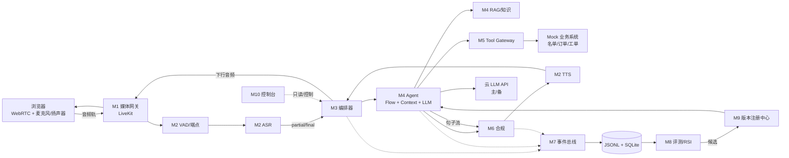

# 10 · 总汇总：架构 / API / 工作清单

> 一页给团队对齐。详细契约见 [03](03-interface-contract-v0.1.md)，事件见 [04](04-event-schema-v0.1.md)，交付见 [09](09-delivery-runtime.md)。
> 范围：三周、单一业务场景、可演示闭环；不追求多场景/高并发/长期记忆。

---

## 0. 一页结论

| 项 | 结论 |
|---|---|
| 目标 | 浏览器 WebRTC 实时语音外呼；≥3 轮；首字 P50 ≤2s；完整闭环 + 回写；合规 0 严重违规 |
| 形态 | 模块化单体 + 单进程 asyncio；进程内事件总线；SQLite/JSONL；不引入 MQ/微服务 |
| 语音 | 交付用 CPU（sherpa-onnx ASR/TTS）；3090 仅开发/评测 |
| LLM | 云 API（OpenAI 兼容）+ 主备 Router；本地 14B 仅降级 |
| 业务 | Flow Pack 配置化；一个主场景（通用服务外呼）+ 一个备用包 |
| 合规 | 三层：生成前约束 → 句级门禁 → 工具守卫；BLOCK 必须中断 TTS |
| 交付 | `docker compose --profile cpu up`；模型内置；localhost/HTTPS；无隧道 |
| 团队 | 天命（架构/编排/网关/事件/版本/集成）、SinCircle（语音）、pseudonym（Agent）、湖中日月（评测/RSI）、cx（前端/演示） |

---

## 1. 整体架构

### 1.1 逻辑图



### 1.2 模块职责

| 模块 | Owner | 负责 | 不负责 |
|---|---|---|---|
| M1 接入与媒体 | 天命 + cx | WebRTC、ICE/TURN、抖动缓冲、录音、客户端 AEC 协调 | 业务、ASR/TTS 逻辑 |
| M2 实时语音 | SinCircle | VAD/端点、ASR、TTS、热词、首包、打断检测 | 取消调度、业务状态、合规 |
| M3 编排器 | 天命 | Session/Turn、取消、超时、下行队列、`turn_id` 隔离 | 业务状态、话术、RAG |
| M4 Agent | pseudonym | Flow Engine、上下文、意图/槽位、LLM、RAG、工具决策、兜底 | 实际业务 API、TTS、WebRTC |
| M5 Tool Gateway | 天命 | 工具注册、参数校验、超时、重试、幂等、审计、Mock | 决定“调不调”（M4 决定） |
| M6 合规 | pseudonym + 天命 + 湖中日月 | 三侧检查、ALLOW/REWRITE/BLOCK/TRANSFER、规则与测试 | 生成话术（只改写/拦截） |
| M7 数据与可观测 | 天命 | 事件、trace、存储、回放、指标聚合 | 业务决策、评测判定 |
| M8 评测/RSI | 湖中日月 | 评测集、Judge、归因、候选、回归、报告 | 直接改生产配置/代码 |
| M9 版本注册 | 天命 | 5 类工件、pin、promote、rollback | 执行任务逻辑 |
| M10 控制台 | cx | 字幕、状态、事件时间线、指标、回放 | 核心语音链路 |

### 1.3 依赖红线

- **只有 M3** 能启动/取消 Turn、写会话状态。
- ASR/TTS **不得直接调 M4**；只通过 M3 的事件/队列。
- M4 不得直接调 TTS/业务 HTTP；TTS 经 M6，业务经 M5。
- M5 不得绕过合规；M6 不得被跳过。
- M8 不得直接写生产配置；只能写候选，由 M9 晋升。
- 所有跨模块交互 = 类型化调用或事件；禁止共享可变全局状态。

### 1.4 一次对话（正常）

```text
SpeechStarted → VadEndpoint → ASRFinal
→ TurnCommitted(input) → AgentStarted → AgentFirstToken → AgentSentence(1..n)
→ ComplianceChecked(每句) → TTSFirstChunk → PlaybackFirstFrame
→ TTSCompleted → PlaybackEnded → TurnCommitted(result)
```

### 1.5 打断

```text
ClientSpeechStarted → ClientLocalMuted → BargeInDetected
→ CancelRequested → CancelAcked(Agent/TTS)
→ TurnAborted(old) → TurnStarted(new)
```

规则：客户端本地 VAD 立即静音（≤50ms）；服务端取消是异步补偿；下行音频按 `turn_id` 丢弃过期块；误打断 300ms 内无后续语音则从下一句继续。

### 1.6 两个状态机

| 状态机 | 归属 | 内容 |
|---|---|---|
| 会话/轮次 | M3 | IDLE → CONNECTING → GREETING → LISTENING → USER_SPEAKING → ENDPOINTING → THINKING → SPEAKING → WRAP_UP → CLOSING → ENDED；异常 DEGRADED/FAILED |
| 业务流程 | M4 Flow Pack | OPEN → IDENTITY_CONFIRM → NEED_CONFIRM → OFFER → RESULT_CONFIRM → WRITEBACK → CLOSE；任意状态可 TRANSFER/END/FALLBACK |

> 运行时共性归 M3，业务个性归 M4；换场景只改 Flow Pack。

### 1.7 部署（交付）

```text
主办方设备（CPU-only 假设，Docker Compose）
  web :3000
  app :8080（FastAPI + Orchestrator/Agent/Gateway/Compliance）
  livekit :7880/7881/7882udp
  coturn :3478/5349
  asr :10095（sherpa-onnx CPU）
  tts :9880（sherpa-onnx VITS CPU）
  LLM → 云 API（唯一出网依赖）
```

关键：模型内置；`localhost` 访问（麦克风安全上下文）；跨机用 HTTPS + TURN；不放隧道；无 Key/断网走 `DEGRADED` + 预置话术。

### 1.8 关键决策

1. 模块化单体，不微服务；先跑通再拆。
2. 单一编排者；`turn_id` 贯穿音频与事件。
3. 双状态机分离（运行时 vs 业务）。
4. Agent 只决策，Gateway 只执行；工具调用可归因。
5. 合规三层；流式按句门禁；BLOCK 能中断 TTS。
6. Flow Pack 配置化；换场景不改代码。
7. 事件是唯一事实来源；`TurnLatency` 统一时延口径。
8. 版本注册 + session pin；RSI 只通过候选晋升。
9. 客户端本地静音 + 服务端异步取消（打断 ≤300ms 的前提）。
10. 交付 CPU-only Docker；3090 只做开发/评测。

---

## 2. API 规范（速查）

> 完整字段见 03；这里只列团队日常要用的。

### 2.1 全局约定

| 项 | 规则 |
|---|---|
| `session_id` | `s_` + ULID |
| `turn_id` | `t_` + 4 位，会话内递增；只由 M3 分配 |
| `trace_id` | `tr_` + 16 hex；一次用户输入→回复 |
| `reply_id` | `r_` + turn + attempt；M3 分配，Agent 透传 |
| 时间 | `ts` ISO8601 + `ts_mono_ms` 单调；延迟只用 mono |
| 音频上行 | PCM16LE / 16k / 单声道 / 20ms |
| 音频下行 | PCM16LE / 24k / 单声道 / 20–100ms 块 |
| 版本 | 每个 session 固定 `release_id` + 5 类工件 |
| 错误 | `{code, message, retryable, severity, user_message, fallback}` |
| 取消 | `CancelToken`；协作式；chunk 边界检查；300ms 内 `CancelAcked` |

### 2.2 HTTP

| 方法 | 路径 | 用途 |
|---|---|---|
| POST | `/sessions` | 建会话：`{mode, scenario_id?, release_id?}` → `{session_id, token, ws_url, version_set}` |
| GET | `/sessions/{id}/state` | `{turn_state, flow_state, slots, turn_id}` |
| POST | `/sessions/{id}/text` | 文本轮（评测/调试），SSE/NDJSON |
| POST | `/sessions/{id}/cancel` | 调试/管理取消 |
| GET | `/sessions/{id}/events?since_seq=` | NDJSON 事件回放 |
| POST | `/eval/sessions` | `{scenario_id, release_id, mode:"text"}` → `{eval_session_id}` |
| GET | `/eval/sessions/{id}` | 指标 + turns + artifacts |
| POST | `/internal/tools/{tool}/invoke` | Tool Gateway 内部调用 |
| GET | `/healthz` / `/metrics` | 健康检查 / Prometheus |
| GET/POST | `/registry/*` | 生产版本、候选、晋升、回滚 |

### 2.3 WebSocket / DataChannel

客户端 → 服务端：

```json
{"type":"hello","session_id":"s_...","client_version":"web@0.1","capabilities":["local_vad","aec"]}
{"type":"speech_started","client_ts_ms":...,"client_mono_ms":...,"energy_db":-32.1,"source":"local_vad"}
{"type":"speech_ended","reason":"local_vad"}
{"type":"playback_first_frame","turn_id":"t_0003","reply_id":"r_0003_1","client_mono_ms":...,"audio_ctx_time":...}
{"type":"local_muted","turn_id":"t_0003","client_mono_ms":...,"reason":"barge_in"}
{"type":"ping","t":...}
```

服务端 → 客户端：

```json
{"type":"session_ready","session_id":"s_...","version_set":{...},"ice_servers":[...]}
{"type":"state","turn_state":"LISTENING","flow_state":"NEED_CONFIRM","slots":{...},"turn_id":"t_0004"}
{"type":"transcript","turn_id":"t_0004","text":"我想改到明天下午","final":true}
{"type":"agent_text","turn_id":"t_0004","reply_id":"r_0004_1","sentence_id":1,"text":"可以的...","final":false}
{"type":"audio_chunk","turn_id":"t_0004","reply_id":"r_0004_1","sentence_id":1,"seq":1,"pcm_b64":"...","is_last":false}
{"type":"cancel","turn_id":"t_0004","reason":"BARGE_IN"}
{"type":"pong","t":...,"server_mono_ms":...}
{"type":"error","error":{...}}
```

### 2.4 Agent

```python
class Agent(Protocol):
    async def start_session(self, session_id: str, version_set: dict[str, str],
                            flow_pack: dict) -> None: ...
    async def handle(self, req: AgentRequest, cancel: CancelToken,
                     tools: ToolClient) -> AsyncIterator[AgentChunk]: ...

@dataclass
class AgentRequest:
    session_id: str; turn_id: str; trace_id: str; reply_id: str
    user_text: str; asr_conf: float
    dialog_state: dict; recent_turns: list[dict]
    language: str = "zh-CN"
```

`AgentChunk`：

```json
{"kind":"sentence","reply_id":"r_0004_1","sentence_id":1,"text":"可以的，我先帮您看一下订单。","final":false}
{"kind":"transfer","reply_id":"r_0004_1","reason":"user_request","queue":"human","summary":"用户要求人工"}
{"kind":"end","reply_id":"r_0004_1","outcome":"rescheduled","slots":{"order_id":"A12345678"},"result":{"new_time":"2026-11-01T15:00"}}
{"kind":"error","reply_id":"r_0004_1","error":{"code":"LLM_TIMEOUT","message":"...","retryable":true}}
```

规则：首句 ≤20 字；Agent 不产音频、不直连业务 API；工具通过 `ToolClient`；异常必须转 `error`。

### 2.5 Voice

```python
class AsrStream(Protocol):
    async def push(self, frame: AudioFrame) -> None: ...
    async def finish(self) -> None: ...
    def events(self) -> AsyncIterator[AsrEvent]: ...   # partial/final/error
class TtsAdapter(Protocol):
    async def synthesize(self, text: str, *, voice: str, sample_rate: int,
                         cancel: CancelToken) -> AsyncIterator[AudioChunk]: ...
class Vad(Protocol):
    def push(self, frame: AudioFrame) -> list[VadEvent]: ...
```

交付实现：`SherpaCpuAsr`、`SherpaCpuTts`、`SileroVad`；开发实现：`FunAsr`、`CosyVoice`。适配器不感知 session/业务。

### 2.6 Tool Gateway

```python
class ToolClient(Protocol):
    async def invoke(self, tool: str, args: dict, *,
                     idempotency_key: str | None = None,
                     deadline_ms: int = 2000) -> ToolResult: ...
```

```http
POST /internal/tools/order.query/invoke
X-Session-Id / X-Turn-Id / X-Trace-Id
{"args":{"order_id":"A12345678"},"idempotency_key":"...","deadline_ms":2000}
```

```json
{"ok":true,"data":{"order_id":"A12345678","status":"delivering"},
 "meta":{"attempt":1,"cached":false,"latency_ms":123,"tool_version":"order.query@1.2.0"}}
```

错误码：`TOOL_INVALID_ARGS` / `TOOL_NOT_FOUND` / `TOOL_PERMISSION_DENIED` / `TOOL_TIMEOUT` / `TOOL_5XX` / `TOOL_RATE_LIMIT` / `TOOL_CONFLICT`。
幂等键默认 `sha256(session|turn|tool|canonical_args|business_key)`；SQLite TTL 24h；只对超时/5xx/429 重试 1 次。

### 2.7 合规

```python
class Compliance(Protocol):
    async def check_input(self, text: str, ctx: dict) -> GuardResult: ...
    async def check_sentence(self, text: str, ctx: dict) -> GuardResult: ...
    async def check_tool(self, tool: str, args: dict, ctx: dict) -> GuardResult: ...

# GuardResult: decision in {ALLOW, REWRITE, BLOCK, TRANSFER},
#              text, rule_ids, severity, latency_ms
```

`rules.yaml`：`must_say`（AI 身份、录音提示）、`forbidden`（虚假承诺/隐私/诱导）、`transfer`（转人工/投诉）。首句检查 P95 ≤50ms；BLOCK 触发 TTS 取消。

### 2.8 版本注册

Manifest：

```json
{"release_id":"rel_20261101_01","status":"candidate","parent_release_id":"rel_...",
 "artifacts":{
   "flow":{"name":"service_outbound","version":"1.0.0","sha256":"..."},
   "prompt":{"name":"agent_system","version":"12","sha256":"..."},
   "knowledge":{"name":"faq","version":"2026-10-31","sha256":"..."},
   "model":{"name":"deepseek-chat","version":"2026-10","sha256":"..."},
   "config":{"name":"runtime","version":"8","sha256":"..."}},
 "metrics":{"task_success":0.82,"p50_ms":1180,"p95_ms":1900,"compliance_pass":1.0}}
```

`candidate → production → previous`；D 写候选，天命 promote/rollback；session 固定 pin。

### 2.9 事件

Envelope：

```json
{"schema_version":"1.0","event_id":"evt_...","seq":42,"type":"ASRFinal",
 "ts":"...","ts_mono_ms":...,"clock_id":"app-...",
 "session_id":"s_...","turn_id":"t_0003","trace_id":"tr_...",
 "span_id":"sp_...","parent_span_id":null,"module":"voice.asr",
 "release_id":"rel_...","mode":"voice","payload":{},
 "latency_ms":null,"ok":true,"error":null}
```

核心事件：`SessionStarted/Ended`、`TurnStarted/Committed/Aborted`、`SpeechStarted/Ended/VadEndpoint`、`ASRPartial/Final`、`AgentStarted/FirstToken/Sentence/Completed`、`ComplianceChecked/Blocked/Rewritten`、`ToolCalled/Returned/Failed`、`TTSStarted/FirstChunk/Completed/Cancelled`、`PlaybackFirstFrame/Ended`、`BargeInDetected/Confirmed`、`CancelRequested/Acked`、`ProviderCalled/FirstToken/Failed/Failover`、`TurnLatency`。

`TurnLatency.payload` 必带 `t0..t9`、`e2e_ms`、`e2e_official_proxy_ms`、`clock_offset_ms`、`clock_suspect`。

### 2.10 Flow Pack（最小示例）

```yaml
id: service_outbound
version: 1.0.0
entry: OPEN
states:
  OPEN:
    say: "您好，我是{company}智能客服{name}，本次通话会录音。请问是{name}本人吗？"
    must_say: [ai_identity, recording_notice]
    next: IDENTITY_CONFIRM
  IDENTITY_CONFIRM:
    transitions:
      - {when: {intent: confirm}, to: NEED_CONFIRM}
      - {when: {intent: deny}, to: END}
  NEED_CONFIRM: {ask: "想跟您确认一下，您今天方便收货吗？", slots: [order_id], next: OFFER}
  OFFER: {say: "可以帮您改到明天下午 3 点，您看方便吗？", next: RESULT_CONFIRM}
  RESULT_CONFIRM:
    transitions:
      - {when: {intent: confirm}, to: WRITEBACK}
      - {when: {intent: deny}, to: OFFER_ALT}
  WRITEBACK: {tool: order.reschedule, next: CLOSE}
  CLOSE: {say: "已为您改约成功，稍后会收到短信。", next: END}
slots:
  order_id: {required: true, ask: "方便提供订单号吗？", pattern: "^[A-Z0-9]{8,20}$"}
```

---

## 3. 团队工作清单

> 优先级：P0 = W1 必须；P1 = W2；P2 = W3。验收以“可演示/可测试”为准。

### 3.1 天命（架构/集成）

| ID | 工作 | 产出 | 验收 |
|---|---|---|---|
| A1 | 契约会签与变更管理 | 03/04 冻结；CHANGELOG | 四人能跑契约测试 |
| A2 | 仓库骨架 + CI + `make contract-test` | 目录、make、schema | 新机器能跑 |
| A3 | Fake 全链路 + EventBus + 回放 | 3 轮会话、≥15 事件 | seq 连续、可回放 |
| A4 | Tool Gateway + mock-business + 幂等 | 查询/改约/工单 | 重放不重复建单 |
| A5 | CPU Docker Compose + healthcheck + 模型内置 | `--profile cpu` 一键起 | 干净 VM ≤10min |
| A6 | LiveKit/coturn + WebRTC + localhost/HTTPS | 同机/跨机通话 | 麦克风可用 |
| A7 | 打断取消 + 下行队列 + `turn_id` 隔离 | `CancelAcked`、无残留 | 停止 ≤300ms |
| A8 | 版本注册 + pin/promote/rollback | manifest、state.json | 回滚 ≤60s |
| A9 | LLM Router + 预算 + 主备 | providers.yaml、事件 | 429/超时能切 |
| A10 | 合规守卫集成（3 调用点） | 句级 BLOCK 中断 TTS | 禁语召回 100% |
| A11 | Eval headless runner | `/eval/sessions` | D 可独立跑批 |
| A12 | 性能收敛 + 演示 + 提交镜像 | P50/P95 报表、tar | W3 彩排通过 |

### 3.2 SinCircle（语音）

| ID | 工作 | 产出 | 验收 |
|---|---|---|---|
| B1 | VAD/端点 | `VadEvent`、端点参数 | P50≤300ms |
| B2 | CPU ASR 适配器（sherpa-onnx） | `AsrStream` | final≤250ms |
| B3 | CPU TTS 适配器（sherpa-onnx VITS） | `TtsStream` | 首包≤300ms |
| B4 | 3090 基线（FunASR/CosyVoice） | 对照数据 | 用于选型，不进交付 |
| B5 | 打断检测 + 时间戳 | `SpeechStarted` | 检测≤200ms |
| B6 | 抗噪/双讲 | 噪声测试报告 | 50dB 可懂 |
| B7 | 首包/延迟调优 | 数据报表 | 达标或给出上限 |
| B8 | 预合成/音色 | 开场白音频、音色选择 | 首字受益 |

### 3.3 pseudonym（Agent）

| ID | 工作 | 产出 | 验收 |
|---|---|---|---|
| C1 | Flow Pack schema + 内容 | YAML + 校验 | 可跑 6 阶段 |
| C2 | Agent 接口实现 | `handle()` | 契约测试通过 |
| C3 | 意图/槽位 | 规则 + LLM 混合 | 意图≥90%、槽位 F1≥0.85 |
| C4 | Prompt/结构化输出 | JSON Schema | 解析失败可降级 |
| C5 | RAG/知识 | 检索 + 引用 | 引用 100% |
| C6 | 工具决策/参数 | ToolClient 调用 | 选择≥95% |
| C7 | 合规规则/改写 | rules.yaml | 必说/禁语可触发 |
| C8 | 兜底/转人工 | 异常分支 | 不悬挂 |
| C9 | 版本化工件 | prompt/flow 版本 | 可被 Registry pin |

### 3.4 湖中日月（评测/RSI）

| ID | 工作 | 产出 | 验收 |
|---|---|---|---|
| D1 | 评测集 v0（dev/val/test） | ≥30/20/20 场景 | 覆盖正常/边界/对抗 |
| D2 | 指标 + Judge | 脚本 + 人工抽检 | Judge 一致≥80% |
| D3 | 失败归因 | 分类报告 | 覆盖 ASR/Agent/工具/合规 |
| D4 | RSI 候选 + 回归 | baseline vs candidate | +3pp、门槛不回退 |
| D5 | 自测报告 + 原始日志 | 报告 + logs | 可复算 |
| D6 | 合规测试集 | 必说/禁语/对抗 | 召回 100% |
| D7 | 测试音频方案 | 音频 + 转写 + 同意 | 口径确认 |

### 3.5 cx（前端/演示）

| ID | 工作 | 产出 | 验收 |
|---|---|---|---|
| E1 | WebRTC 客户端 | 连接、重连 | 弱网可恢复 |
| E2 | AudioWorklet 采集/播放 | 16k 上行/24k 下行 | 无爆音/延迟可控 |
| E3 | 字幕/状态 UI | 实时字幕、槽位 | 可演示 |
| E4 | 事件时间线/指标 | 回放、P50/P95 | 答辩可用 |
| E5 | 本地 VAD 静音 | `local_muted` | ≤50ms |
| E6 | 视频/PPT/答辩 | 5min 视频、7min PPT | 两次彩排 |

### 3.6 跨人协作

| ID | 工作 | Owner | 验收 |
|---|---|---|---|
| X1 | 每周一次集成 + 异步同步 | 天命 | 阻塞不过周 |
| X2 | 每周一次 3min 演示 + 指标页 | 天命 + cx | 可复现 |
| X3 | 干净 VM 一键启动演练 | 天命 | 每周一次 |
| X4 | 提交包（方案书/报告/视频/清单） | 天命 + 全员 | 08 checklist 全绿 |

---

## 4. 天命个人工作清单（按优先级）

### P0（D0–D2，必须先做）

| # | 事项 | 完成标准 |
|---|---|---|
| 1 | 会签 03/04，冻结接口 | 四位 owner 无异议；CHANGELOG 建立 |
| 2 | 建 repo + CI + `make contract-test` | 一条命令跑 schema/fixtures |
| 3 | Fake 全链路（3 轮） | 浏览器按钮 → 字幕 → 回放 |
| 4 | EventBus + JSONL/SQLite + `TurnLatency` | `seq` 连续；`t0..t9` 可算 |
| 5 | Tool Gateway + mock + 幂等 | 重放不重复建单 |
| 6 | CPU Docker 骨架 | `--profile cpu up` 可起 |

### P1（W2）

| # | 事项 | 完成标准 |
|---|---|---|
| 7 | 接 CPU ASR/TTS（SinCircle） | 真实 3 轮有声音 |
| 8 | LiveKit/coturn + localhost/HTTPS | 同机/跨机各一次 |
| 9 | 打断取消 + `turn_id` 过滤 | 停止 ≤300ms，无残留 |
| 10 | 合规守卫 3 调用点 | 禁语 100% 拦截，能中断 TTS |
| 11 | Version Registry + pin/rollback | 回滚 ≤60s |
| 12 | LLM Router + 预算 | 429/超时切备 |
| 13 | Eval headless runner | D 独立跑 5 条 |
| 14 | WebRTC 替换 WS 骨架 | 控制面 JSON 不变 |

### P2（W3）

| # | 事项 | 完成标准 |
|---|---|---|
| 15 | 模型烘进镜像 + 干净 VM | 8C/16GB 无 GPU ≤10min |
| 16 | P50/P95 收敛 | P50≤1.2s、P95≤2s |
| 17 | 演示脚本 + 断网/无 Key 演练 | 不白屏，3min 完成 |
| 18 | 提交镜像 tar + README + `.env.example` | 评委视角可复现 |
| 19 | 提交包联调（方案书/报告/视频） | 08 checklist 全绿 |

### 不做清单

- 不写 ASR/TTS 模型内部（SinCircle）
- 不调 Agent Prompt/状态机（pseudonym）
- 不写 Judge/评测指标（湖中日月）
- 不做复杂前端（cx）
- 不做多场景/长期记忆/微服务/MQ
- 不在 W1 调本地 14B

### 每周节奏

- 每周一次集成窗口（60–90 分钟，时间自定）：只联调，不开发。
- 集成后跑 `make smoke` + 时延报表。
- 每周一次 3min 演示 + Gate（可与集成合并）。
- 日常群消息异步报「完成/阻塞/需要接口」，不强制在线。

### 阻塞升级

- 接口歧义 >半天 → 天命拍板并改契约。
- 外部依赖 >1 天不可用 → 切 Fake/备用。
- 某人阻塞联调 >2 天 → 天命给 Fake 实现。

---

## 5. 里程碑与 Gate

| 周 | 必须达成 | Gate |
|---|---|---|
| W1 | Fake 3 轮 + 事件回放；文本 Agent + 工具 + headless；首版真实语音 | 3 轮可回放、工具幂等、`TurnLatency` 有值 |
| W2 | CPU 语音 + WebRTC + 六阶段闭环 + 合规 + 批量评测 + 干净 VM | P50 有数、禁语 100%、Docker ≤10min |
| W3 | P50/P95 达标、RSI 一组 A/B、提交包、两次彩排 | 08 checklist 全绿 |

---

## 6. 暂不决定（Parking Lot）

> 不阻塞本周，按假设推进；有结论再改配置，不改接口。

- 官方时延口径/工具、场景资料、Mock 接口
- 主办方设备具体配置、浏览器位置、交付格式/大小限制
- 云 LLM 供应商与预算
- TTS 是否允许云作为可选 profile
- 测试集录音音频的具体口径
- 答辩日期/PPT 模板

**当前假设**：CPU-only 8C/16GB、Docker Compose、localhost 访问、LLM 云、ASR/TTS CPU、单场景。
