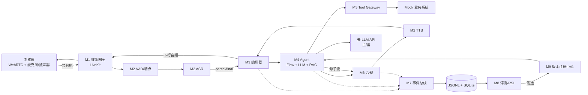

# 12 · 技术方案书（初稿）

> 项目：智语外呼——语音外呼客服数字员工实时语音交互与自主进化
> 状态：**初稿**。Fake 骨架数据已填；真实 ASR/TTS/LLM/WebRTC 数据待 W3 替换（标记 `[W3实测]`）。
> 依据：[01 矩阵](01-requirement-metric-module-matrix.md) · [02 架构](02-architecture-v0.1.md) · [03 契约](03-interface-contract-v0.1.md) · [11 v0.2](11-contract-v0.2-patch.md)

---

## 0. 摘要

本方案用“**确定性骨架 + 可替换模型 + 可回滚进化**”构建外呼数字员工：

- 浏览器 WebRTC 接入，流式 VAD/ASR/TTS，支持打断与取消。
- 双状态机：运行时状态归编排器，业务状态归 Flow Pack；LLM 只做理解与表达，不自由改流程。
- 合规三层：生成前约束、句级门禁、工具守卫；BLOCK 可中断已生成的语音。
- 统一事件日志是调试、评测、RSI、答辩的同一份事实来源。
- RSI 只改“工件”（prompt/flow/knowledge/tool policy），经候选、回归门禁、晋升/回滚，不直接改生产。
- 交付为 CPU-only Docker，现场不依赖自建 GPU/隧道；LLM 走云 API。

当前已跑通 **Fake 全链路、Tool Gateway、合规、打断、Registry、LLM Router、RAG、Flow Pack、Eval Runner、RSI 门禁、自测报告**；真实语音/媒体服务待接。

---

## 1. 赛题理解

### 1.1 三条硬门槛

| 门槛 | 目标 | 架构动作 |
|---|---|---|
| ≥3 轮连续实时语音 | 10 轮稳定 | 双状态机 + 取消/超时 + 长会话回归 |
| 首字 P50 ≤2s | 内控 P50 ≤1.2s、P95 ≤2s | 全流式、同区域 LLM、预合成开场白、句级合规 |
| 完整闭环 + 回写 | 六阶段 + 结构化结果 | Flow Pack + Tool Gateway + 契约测试 |
| 无严重合规违规 | 必说 100%、禁语召回 100% | 三层合规 + 规则测试集 + 质检报告 |

### 1.2 评分维度与策略

实时语音、任务完成、知识/工具、合规/质检、工程/创新、跨学科协作六个维度**不拿 0 分**；创新分集中在 Flow Pack + RSI + 可回滚。

### 1.3 设计原则

1. 先骨架、后模块；先接口、后实现；先跑通、后优化。
2. 模块化单体，不引入 MQ/微服务/K8s。
3. 所有跨模块交互 = 类型化调用或事件。
4. 外部依赖必须有适配器与降级。
5. 一切可回放；session 固定版本。
6. 只为已测量的瓶颈增加复杂度。

---

## 2. 总体架构

### 2.1 逻辑图



### 2.2 模块职责

| 模块 | 负责 | 不负责 |
|---|---|---|
| M1 接入与媒体 | WebRTC、ICE/TURN、抖动缓冲、客户端 AEC 协调 | 业务、ASR/TTS 逻辑 |
| M2 实时语音 | VAD/端点、ASR、TTS、热词、首包、打断检测 | 取消调度、业务状态 |
| M3 编排器 | Session/Turn、取消、超时、下行队列、`turn_id` 隔离 | 业务状态、话术、RAG |
| M4 Agent | Flow Engine、上下文、意图/槽位、LLM、RAG、工具决策、兜底 | 实际业务 API、TTS、WebRTC |
| M5 Tool Gateway | 工具注册、参数校验、超时、重试、幂等、审计、Mock | 决定“调不调” |
| M6 合规 | 输入/句级/工具三侧检查、改写/拦截/转人工 | 生成话术 |
| M7 数据与可观测 | 事件、trace、存储、回放、指标聚合 | 业务决策、评测判定 |
| M8 评测/RSI | 评测集、Judge、归因、候选、回归、报告 | 直接改生产 |
| M9 版本注册 | 5 类工件、pin、promote、rollback | 执行业务逻辑 |
| M10 控制台 | 字幕、状态、事件时间线、指标、回放 | 核心语音链路 |

### 2.3 依赖红线

- 只有 M3 启动/取消 Turn、写会话状态。
- ASR/TTS 不得直接调 M4；只通过 M3 的事件/队列。
- M4 不得直接调 TTS/业务 HTTP；TTS 经 M6，业务经 M5。
- M5 不得绕过合规；M6 不得被跳过。
- M8 不得直接写生产；只能写候选，由 M9 晋升。

### 2.4 部署形态

```text
主办方设备（CPU-only 假设，Docker Compose）
  web+app  :8081（容器内 8080）
  livekit  :7880/7881/7882udp
  coturn   :3478/5349
  asr/tts  CPU 模型（W2 接入）
  LLM      → 云 API（唯一出网依赖）
```

模型内置镜像；`localhost` 访问保证麦克风安全上下文；跨机才用 HTTPS；不做隧道。

---

## 3. 实时语音

### 3.1 一轮链路

```text
SpeechStarted → VadEndpoint → ASRFinal
→ TurnCommitted(input) → AgentStarted → AgentFirstToken → AgentSentence
→ ComplianceChecked → TTSFirstChunk → PlaybackFirstFrame
→ TTSCompleted → PlaybackEnded → TurnCommitted(result) → TurnLatency
```

### 3.2 VAD 与端点

- 目标：端点 P50≤300ms、误切≤2%、漏切≤3%。
- 策略：能量/零率 + 语义端点可配；客户端本地 VAD 用于打断，服务端 VAD 用于轮次。
- 打断判据：本地连续 3 帧（60ms）越限的第一帧为 `b0`。

### 3.3 ASR

- 交付：sherpa-onnx 中文流式（CPU）；开发：FunASR（3090）做对照。
- 指标：CER≤8%、实体≥95%、final≤250ms（CPU）。
- 热词：订单号、权益名、业务术语。

### 3.4 TTS

- 交付：sherpa-onnx VITS（CPU）；开发：CosyVoice（3090）做自然度上限。
- 指标：首包≤300ms、可懂度≥98%、MOS≥4.0（目标）。
- 取舍：CPU TTS 自然度低于 CosyVoice；用预合成开场白、短句、音色选择缓解。
- `tts_alignment=false`：Fake/CPU 阶段没有真实音频时间轴，前端按字数估算并标“估算”。

### 3.5 打断

```text
ClientSpeechStarted → ClientLocalMuted → BargeInDetected
→ CancelRequested → CancelAcked(Agent/TTS)
→ TurnAborted(old) → TurnStarted(new)
```

- 客户端本地立即静音，不等服务端 RTT。
- 服务端取消是异步补偿；下行音频按 `turn_id` 丢弃过期块。
- 两个指标分开：用户可感停止 `b3-b0`（≤100ms）、服务端静默 `confirmed-b0`（≤300ms）。

### 3.6 抗噪与双讲

- 浏览器 AEC + 耳麦；50dB 噪声源回放测试。
- 双讲：AEC 参考信号 + TTS 播放期半双工兜底（可配）。
- 指标：CER 退化≤3pp、任务完成率退化≤5pp。

---

## 4. Agent

### 4.1 双状态机

| 状态机 | 归属 | 内容 |
|---|---|---|
| 会话/轮次 | M3 | IDLE → GREETING → LISTENING → USER_SPEAKING → THINKING → SPEAKING → WRAP_UP → ENDED；异常 DEGRADED/FAILED |
| 业务流程 | M4 Flow Pack | OPEN → IDENTITY_CONFIRM → NEED_CONFIRM → OFFER → RESULT_CONFIRM → WRITEBACK → CLOSE；可 TRANSFER/END/FALLBACK |

### 4.2 Flow Pack

流程、槽位、话术、合规、工具绑定全部 JSON 配置；换场景只改配置，不改代码。示例：`flowpacks/service_outbound.json`。

### 4.3 意图与槽位

- 规则 + LLM 混合；槽位定义、必填、追问模板在 Flow Pack。
- 指标：意图≥90%、槽位 F1≥0.85、主动追问命中≥90%。

### 4.4 RAG

- 本地知识库 + 中文 token/bigram 检索；返回 `doc_id/title/score` 引用。
- 生产可替换为 bge-m3 + 向量检索，接口不变。
- 指标：准确率≥85%、引用 100%、幻觉≤5%。

### 4.5 工具

- 所有业务调用经 Tool Gateway：schema 校验、权限、超时、重试、幂等、审计。
- 幂等键 = `sha256(session|turn|tool|canonical_args|business_key)`；TTL 24h。
- 指标：选择≥95%、参数≥90%、成功≥98%、幂等 100%。

### 4.6 兜底

- LLM 超时/限流 → 备用云 → 模板话术 → 转人工。
- 工具失败 → 重试 1 次 → 登记待办 → 转人工。
- 不改流程自由发挥；未知意图走 FALLBACK。

---

## 5. 合规与安全

### 5.1 三层

1. **生成前**：禁用话术注入 system prompt + Flow Pack 状态约束。
2. **句级门禁**：每个 `AgentSentence` 送 TTS 前检查；首句 P95≤50ms；BLOCK 取消当前 reply 的 TTS。
3. **工具守卫**：调用前检查工具白名单与参数。

### 5.2 决策

`ALLOW | REWRITE | BLOCK | TRANSFER`；规则含 `must_say`（AI 身份、录音提示）、`forbidden`（虚假承诺、隐私、诱导）、`transfer`（转人工/投诉）。

### 5.3 质检

- 全量转写 + 合规命中 + 改写前后对照 + 质检报告。
- 指标：必说 100%、禁语召回 100%、误杀≤5%、严重违规 0。

### 5.4 数据安全

- 仅使用脱敏/合成数据；不真实外呼、不使用真实号码。
- AI 身份与录音提示固定；UI/视频标注“AI 合成语音”。
- 日志脱敏；密钥只放服务端。

---

## 6. 数据与可观测

### 6.1 ID 与时间

`session_id`、`turn_id`、`trace_id`、`reply_id`、`call_id`；墙钟 + 单调时钟；客户端 `performance.now()` 同源。

### 6.2 事件

统一 Envelope：`schema_version / event_id / seq / type / ts / ts_mono_ms / session_id / turn_id / trace_id / module / release_id / mode / payload / ok / error`。

核心事件：Session、Turn、Speech/VAD、ASR、Agent、Compliance、Tool、TTS、Playback、BargeIn、Cancel、Provider、TurnLatency。

`TurnLatency` 带 `t0..t9`、`e2e_ms`、`e2e_official_proxy_ms`、`t0_client/t0_vad`、`barge_in_stop_ms`。

### 6.3 存储与回放

- JSONL（append-only）+ SQLite（索引）；DuckDB/Parquet 分析。
- `scripts/replay.py` 回放；`scripts/report.py` 生成自测报告。
- 事件是评测、RSI、答辩的同一份事实来源。

---

## 7. 评测体系

### 7.1 数据集

- 开发/验证/测试三分；测试集不参与调 Prompt。
- 覆盖正常、边界、对抗、噪声、打断、工具失败。
- 目标 ≥100 场景；当前示例 `eval/cases/dev.json` 5 条。

### 7.2 指标

| 类别 | 指标 |
|---|---|
| 实时语音 | P50/P95、打断停止、VAD 端点、CER、MOS |
| 任务 | 意图、槽位 F1、闭环率、纠错、追问 |
| 知识/工具 | RAG 准确率/引用、工具正确率、回写完整率 |
| 合规 | 必说覆盖、禁语召回、误杀、QC 完整度 |
| 工程/RSI | 一键启动、复现偏差、成本、候选提升、回滚 |

### 7.3 Judge

- 规则优先；LLM-as-Judge 只评礼貌性/合理性；人工抽检，一致率≥80%。
- Judge 与主模型不同源，降低自偏好。

### 7.4 失败归因

- 对比“人工参考文本→Agent”和“音频→ASR→Agent”，区分 ASR/VAD/Agent/工具/TTS。
- 失败标签：`compliance_blocked / tool_failed / turn_aborted / task_incomplete / outcome_mismatch`。

### 7.5 当前基线（Fake，仅验证链路）

| 指标 | 值 | 说明 |
|---|---|---|
| 评测集 | 5/5 | 订单、改约、RAG、转人工、合规 |
| P50 | 687ms | Fake Agent + 浏览器 TTS，非真实语音 |
| P95 | 901ms | 同上 |
| 契约事件 | 47/47 | 4 个 fixture |
| 测试 | 21 passed | 含打断、幂等、RSI、报告 |

> 这些数字只证明埋点/链路/门禁可用，**不作为真实语音指标**；W3 替换为真机数据。

---

## 8. RSI 闭环

### 8.1 工件

`flow / prompt / knowledge / model / config` 五类；候选 manifest 带 `release_id/parent/metrics/status`。

### 8.2 流程

```text
对话数据 → 评测 → 失败聚类/归因 → 候选（prompt/flow/knowledge/tool policy）
→ 同一测试集回归 → 与 baseline 比较 → 门槛通过 → 晋升；否则回滚/丢弃
```

### 8.3 回归门禁

- 任务成功率提升 ≥3pp，且 bootstrap 95% CI 下界 >0。
- P50/P95 回退不超过 5%。
- 合规不下降。
- 任一硬门槛回退 → 拒绝。

代码：`app/rsi/gate.py`、`/rsi/compare`、`/rsi/promote`、`scripts/rsi_compare.py`。

### 8.4 防过拟合

- 留出测试集封存；只用于最终评测。
- 候选不得针对已知 case 特判；代码审计 + 现场随机抽测。
- 失败聚类按“能力缺口”而不是“单题答案”。

### 8.5 回滚

`candidate → production → previous`；回滚 ≤60s；session 固定 `release_id`。

---

## 9. 时延预算与实测

### 9.1 预算（保守口径 `t9-t0`）

| 阶段 | P50 | P95 |
|---|---|---|
| 本地 ASR final | 120 | 250 |
| 云 LLM TTFT | 350 | 750 |
| 首句 + 合规 | 125 | 250 |
| 本地 TTS 首包 | 180 | 350 |
| 下行/播放 | 70 | 140 |
| **合计** | **845** | **1740** |

### 9.2 优化杠杆与副作用

| 杠杆 | 副作用 | 验证 |
|---|---|---|
| 预合成开场白 | 话术僵硬 | MOS、重复率 |
| 首句 ≤20 字 | 语义不完整 | 追问率、可懂度 |
| RAG 与 LLM 并行 | 可能先说不该说的 | 合规误杀/幻觉 |
| 同区域 LLM | 成本/可用区 | TTFT P95 |
| 端点更激进 | 误切上升 | 误切率、完成率 |

### 9.3 当前实测

Fake 基线 P50 687ms / P95 901ms；真实语音 `[W3实测]`。

---

## 10. 成本

| 项 | 估算 | 控制 |
|---|---|---|
| LLM | 单次通话几毛到几元 | 日预算 + 单次上限 + 主备 |
| ASR/TTS | 本地 CPU，边际低 | 只开必要服务 |
| 评测/RSI | 按候选数线性增长 | 独立 Key/预算、夜间批跑 |
| 媒体 | LiveKit 自托管 | 单机、低并发 |

原则：不为“用满 GPU”增加复杂度；6×3090 只做开发/评测。

---

## 11. 工程与复现

- `docker compose up -d --build`；宿主 8081，容器 8080。
- `make test`、`make contract-test`、`make e2e`、`make report`。
- 契约 Schema + fixtures；CI 校验事件。
- 版本注册 + session pin；回滚 tag：`p0-fake-skeleton`、`v0.2.1-cx-conditions`、`rsi-report`、`e2e-ws`。
- 开源清单：`THIRD_PARTY.md`。

### 11.1 当前实现状态

| 能力 | 状态 |
|---|---|
| Fake 全链路 / 事件 / 回放 | ✅ |
| Tool Gateway / 幂等 / 超时 | ✅ |
| 合规 REWRITE/BLOCK | ✅ |
| Registry / RSI 门禁 | ✅ |
| LLM Router / LLMAgent（Mock 验证） | ✅ 代码；真实 Key 待接 |
| RAG / Flow Pack / Eval / Report | ✅ |
| CPU ASR/TTS | 🟡 适配器边界；模型待接 |
| LiveKit 媒体 | 🟡 Token/消息；服务端待接 |
| Docker 镜像 | 🟡 文件完成；未 build |

---

## 12. 团队分工

| 成员 | 职责 | 关键交付 |
|---|---|---|
| 天命 | 架构、M3 编排、M5 网关、M7 事件、M9 版本、集成/交付 | 契约、骨架、事件、Registry、Docker |
| SinCircle | VAD/ASR/TTS、流式语音、打断检测、抗噪 | 语音适配器、首包/端点数据 |
| pseudonym | Flow/意图/槽位/Prompt/RAG/工具决策/合规规则 | Agent、Flow Pack、规则 |
| 湖中日月 | 评测集、Judge、归因、候选、回归、自测报告 | 指标、失败报告、RSI 数据 |
| cx | WebRTC 前端、音频采集/播放、状态/时间线、视频 | Demo UI、播放埋点、答辩材料 |

协作：每周一次集成窗口；异步报阻塞；接口变更先改契约。

---

## 13. 风险与局限

| 风险 | 缓解 |
|---|---|
| 现场网络/云 LLM 抖动 | 主备、预算熔断、预置话术、本地降级 |
| 远程 GPU 不可达 | 交付 CPU-only；不依赖隧道 |
| CPU TTS 自然度不足 | 预合成、音色选择、云 TTS 可选 |
| 合规与流式冲突 | 句级门禁 + 正则快路径 + BLOCK 中断 |
| RSI 过拟合 | 留出集、盲测、门槛、回滚 |
| 5 人集成漂移 | 契约冻结、Fake 骨架、每周 E2E |
| 官方口径未公布 | 双口径埋点，只换列不改点 |

---

## 14. 附录

- API/事件：[03](03-interface-contract-v0.1.md)、[04](04-event-schema-v0.1.md)、[11](11-contract-v0.2-patch.md)
- 评测/RSI：[08](08-submission-package.md)、`app/rsi/gate.py`
- 交付：[09](09-delivery-runtime.md)
- 开源清单：[THIRD_PARTY.md](../THIRD_PARTY.md)
- 演示脚本/答辩：[08](08-submission-package.md) §8–10
