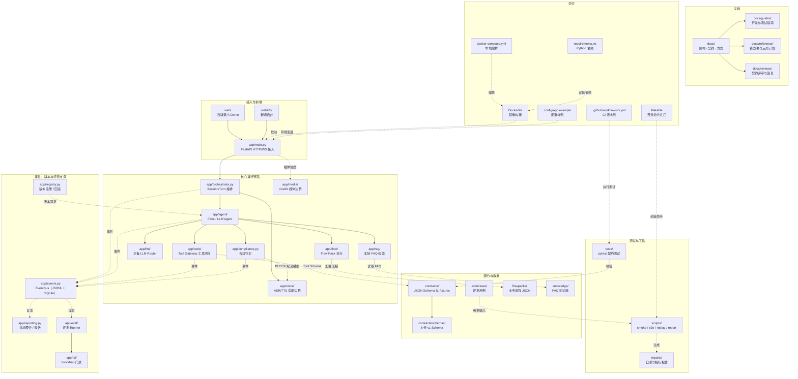

# 仓库结构图

> 本文按 **2026-11-02 的实际目录树**绘制，用于快速定位代码、契约、数据与交付物。
> 图中只保留纳入版本管理的目录；`data/`、`dist/`、`artifacts/`、`.deps/`、`.tmp/`、`__pycache__/`、`.pytest_cache/`、`pytest-cache-files-*` 等生成或缓存目录已省略。

## 1. 总览

> 说明：实线表示运行时调用，虚线表示读取、校验或构建依赖。`app/media/` 与 `app/voice/` 目前是边界占位，真实媒体面尚未接入。

## 2. 顶层目录职责

| 目录 | 职责 |
|---|---|
| `app/` | FastAPI 应用与核心运行链路：入口、编排、Agent、工具网关、合规、LLM、RAG、Flow、事件、Registry、评测与 RSI |
| `web/` | 前端页面；`web/rtc/` 为零依赖 ESM 的新通话台，含音频、协议与会话模块 |
| `contracts/` | 接口契约：JSON Schema、会话 fixtures 与 `validate.py` 校验脚本 |
| `docs/` | 架构、契约、方案、评审与指南；`reference/` 存赛题与计划，`guides/` 存开发/测试指南 |
| `eval/` | 评测用例，当前包含 `cases/dev.json` 与 POP 场景 `cases/pop_audit.json` |
| `flowpacks/` | 业务流程配置，当前包含 `service_outbound.json` 与 `pop_qualification_audit.json` |
| `knowledge/` | 本地知识库，当前包含 `faq.json` 与 POP 场景 `pop_audit.json` |
| `tests/` | pytest 契约与集成测试 |
| `scripts/` | 冒烟、WS E2E、回放、指标检查、报告与 RSI 对比脚本 |
| `reports/` | 自测报告与指标检查结果 |
| `config/` | 配置样例，当前为 `app.example` |
| `.github/` | CI 流水线，当前为 `workflows/ci.yml` |

## 3. 未画入的目录

以下目录或文件由运行与工具链生成，不属于仓库结构：`.git/`、`.deps/`、`.tmp/`、`.uvcache/`、`.uvdata/`、`.uvpython/`、`.pytest_cache/`、`.chrome-tmp*/`、`data/`、`dist/`、`artifacts/`、`__pycache__/`、`pytest-cache-files-*/`、`node_modules/`。新增或移动目录后，同步更新本图与目录表。
